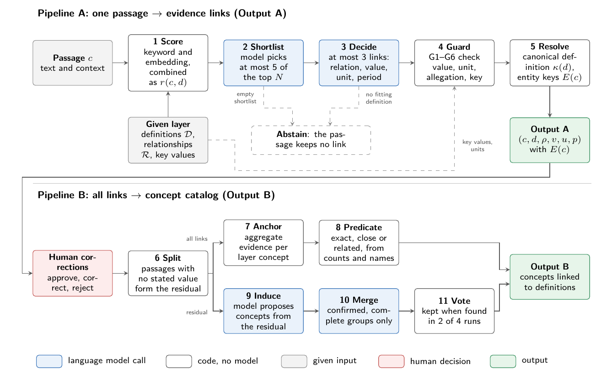

English | [简体中文](README.zh-CN.md)

# Semantic Workspace for Unstructured Data

The Semantic Workspace maps documents, fill-in forms and recorded calls onto a semantic layer that is given and never edited.
It produces evidence links from passages to definitions, an anchored concept catalog, and rows of predefined tables.
A question-answering workspace reads those outputs, computes every number with SQL, and cites the passages behind each answer.

It ships as an AMP for Cloudera AI.
Documentation site: <https://ferdinandzhong.github.io/unstructured-semantic-workspace/>, built from `mkdocs.yml` and `docs/` (see [Documentation](#documentation)).

## Why it matters

AI assistants and agents now work on enterprise data.
In regulated industries every answer must trace back to a governed definition.
Tables have that foundation: a semantic layer names each field and metric, defines it and declares how tables join.
Contracts, forms and recorded calls have none.
The limits, dates and commitments they hold cannot be joined to the tables or governed with them.

This project treats the gap as a mapping task.
For each passage, decide which definitions it states a value of or is about, or abstain.
Then group that evidence into business concepts linked to the layer.
The outputs give documents the same governed vocabulary as tables.

## The paper

**Mapping Unstructured Documents onto a Governed Semantic Layer: Evidence Links and an Anchored Concept Catalog.**
Working draft, 23 November 2026, not reviewed. PDF: [`docs/paper/main.pdf`](docs/paper/main.pdf).

The algorithm lets a small language model choose among retrieved definitions.
Code decides the relation, the value and the entity keys.
Concepts of the layer collect their evidence by aggregation; only unexplained passages reach an induction model.

- On held-out data (gold set A2, 82 anchors, run once), link precision is 0.70, against 0.29 for thresholds and rules.
- On unseen synthetic document packs, link precision reaches up to 0.90, at a false-link rate of 0.01.
- Recall on commitments remains the main limit.
- A question-answering path built on the outputs does not meet its pass bar on any of four unseen exams (11, 14, 18 and 17 of 30).

The evaluation sets are small, one AI annotator wrote each set, and the sets cover two demo datasets.

### How to cite

The paper is a working paper with no venue. Author: Qishuai Zhong (Cloudera).

```bibtex
@unpublished{semantic_workspace_2026,
  author = {Zhong, Qishuai},
  title  = {Mapping Unstructured Documents onto a Governed Semantic Layer:
            Evidence Links and an Anchored Concept Catalog},
  note   = {Working paper, draft of 23 November 2026, not reviewed.},
  year   = {2026},
  url    = {https://github.com/FerdinandZhong/unstructured-semantic-workspace}
}
```

## Inputs and outputs

| | Item | What it is |
| --- | --- | --- |
| Input | Structured data | Tables with rows, loaded read-only into a private PostgreSQL |
| Input | Semantic model | An Ossie YAML file per dataset: fields, relationships, metrics. Given, never edited |
| Input | Unstructured sources | Documents, fill-in XFA forms and audio, pinned by SHA-256, each with a data label |
| Input | Access policy and human decisions | Accounts, withheld sources, corrections, approvals, confirms, releases |
| Output A | Evidence links | For each passage: definition, relation (`states_value_of`, `is_about`, `none`), value, unit, period, entity keys |
| Output B | Concept catalog | Business concepts linked to definitions by a SKOS predicate computed from evidence counts; published as a versioned Ossie release |

The paper defines two outputs, A and B.
The workspace additionally writes table rows as a system feature, written only after a preview and a confirm.
See `docs/output-c.md`. The feature has no measured accuracy result.

## Architecture


At build time, Pipeline A links passages to the semantic model (Output A).
Pipeline B groups that evidence into concepts (Output B).
A person approves and publishes a release.
At question time, a rules-first router sends each request to one of four fixed tools; a model helps only with a request to act that the rules do not complete.



Four of the eleven algorithm steps call a language model. Code does the rest.

## The workspace UI

Each dataset has the same steps.

| Step | What it does |
| --- | --- |
| Sources | Upload and process documents, forms and calls; OCR, form fields and transcription |
| Model | Inspect the tables and definitions of the semantic model |
| Evidence | Review evidence links per passage; approve, correct or reject |
| Concepts | Build the concept catalog (preview, then confirm); review concepts and their links |
| Publish | Publish the approved catalog as a versioned release |
| Ask | Ask questions; explain a term; preview and confirm table writes; list connections |
| Entity 360 | One read-only report per entity: profile, holdings, evidence, concepts, comparisons. Financial Services only |

Ask shows the stages of each request as they run: route, understand, plan, query, read, decide.
An answer carries facts, a conclusion, at most four citations and a summary, or a refusal with its reason.

A switch in the top bar changes the UI language between English and Simplified Chinese.
The server keeps English. Identifiers, numbers and masked values are never translated.

## Deploy as an AMP on Cloudera AI

The AMP creates two jobs and one application. It has not yet run on a real Cloudera AI workspace.

| Step | Script | Notes |
| --- | --- | --- |
| Job `setup_environment` | `cai/setup_environment.py` | Venv from `requirements-v2.lock` plus `pgserver`; app copy; AdventureWorks download; checks. No provider call |
| Job `prepare_demo` | `cai/prepare_demo.py` | Ingests the sources and builds both catalogs with live Mistral calls; about 15 minutes; resumable |
| Application | `cai/start_app.py` | Serves the workspace on `CDSW_APP_PORT` |

Requirements: a Python 3.12 runtime, a Mistral API key, 2 CPU and 8 GB per job and for the application.

| Variable | Required | Meaning |
| --- | --- | --- |
| `MISTRAL_API_KEY` | Yes | Mistral API key; a secret, never printed |
| `MISTRAL_OCR_MODEL` | No | OCR model; default `mistral-ocr-latest` |
| `MISTRAL_AUDIO_MODEL` | No | Transcription model; the manifest default is `voxtral-mini-transcribe-3` |
| `DEMO_HOLD_OUT` | No | Source keys left new for a live ingest; default `MFG-114` |
| `V2_ICEBERG_ROUTE` | No | `trino` writes confirmed rows to Iceberg through Cloudera Lakehouse Engine (Trino) |
| `V2_TRINO_URL` | No | HTTPS URL of the Trino endpoint |
| `V2_TRINO_CA` | No | CA bundle for the Trino endpoint |
| `CDE_TOKEN` | No | Workload token for the Trino route; a secret |

The start script sets `V2_ALLOWED_HOSTS` to `semantic-workspace.<CDSW_DOMAIN>` so the server accepts the application proxy host.
Set it yourself if the public host differs.
The demo accounts are simulated and have no passwords. Keep the application private to the project.
See `docs/deployment.md` for folders, tuning variables and what is untested.

## Run locally

Use Python 3.12 in a dedicated environment. The lock records a tested macOS arm64 environment.

```bash
uv venv --python 3.12 .venv-v2
uv pip install --python .venv-v2/bin/python -r requirements-v2.lock
.venv-v2/bin/python -B -m pytest tests_v2 -q -p no:cacheprovider          # offline; replays recorded replies
.venv-v2/bin/python -I demo_data/manufacturing/scripts/prepare_data.py     # pinned AdventureWorks tables
```

The server needs the PostgreSQL tools `initdb` and `pg_ctl`. Name their folder with `--pg-bin` or `V2_PG_BIN`.
The state directory must be an absolute path outside the repository.

```bash
export MISTRAL_API_KEY=...            # live calls; Mistral receives every processed file
export V2_PG_BIN=/path/to/postgresql/bin
STATE="$HOME/.semantic-workspace-state"
.venv-v2/bin/python -m semantic_pipeline_v2.prepare_demo --state-dir "$STATE"
.venv-v2/bin/python -m semantic_pipeline_v2.workspace_server --state-dir "$STATE" --import-models
```

The server prints its address. The default port is 8137; `--port` changes it.
Run `prepare_demo` before the server: both take the one lock of the state directory.
`prepare_demo` also takes `--dataset`, `--hold-out SOURCE_ID` and `--source`.

## Data and licences

All shipped data is synthetic or carries a public licence.

| Material | Label | Licence and attribution |
| --- | --- | --- |
| Finance structured data: a mock-up banking workbook, 11 tables, 4 to 6 November 2026 | Synthetic | Written for this project |
| Finance documents `FIN-001` to `FIN-012`, adverse-media and report files about fictional companies | Synthetic | Written for this project |
| A review document built from a public chart | Public | CC BY-SA 4.0, Wikimedia Commons |
| FIBO definitions on five finance concepts | Public | MIT, Enterprise Data Management Council |
| Manufacturing tables: AdventureWorks OLTP sample, 25 tables | Public sample | MIT, Microsoft; pinned commit `8fe3fd0c9a825fef3ae6d601e97537b612d7b214` |
| Manufacturing contracts `MFG-001` to `MFG-007`, pack `MFG-101` to `MFG-114` | Synthetic | Written for this project |
| AdventureWorks native documents, as text | Public sample | MIT, Microsoft |

Public files have scope `extraction_only`. They are never induced into concepts and never tied to an entity.
The cleaned customer forms and the recorded call used to build the table-write feature are not in this repository.
See `docs/data.md`.

## Limits

- Recall on commitments is the main limit. The shortlist step drops the right definition for many commitment passages.
- Catalog link recall is 0.29 on the wider corpus. Pipeline B can only anchor what Pipeline A links.
- No unseen question-answering exam met its pass bar.
- Evaluation sets are small and single-annotator. For gold set A2 and the concept set, only the first run is held-out; later rows are development data.
- The table-write feature reads only the form, printed-report, call and labelled-document layouts described in `docs/output-c.md`. It has no schema editor, adds no columns to an existing table, and has no accuracy measurement.
- Approval is the only gate before an approved concept shapes answers.
- The AMP and Linux installation are untested.

## Repository layout

| Path | Holds |
| --- | --- |
| `semantic_pipeline_v2/` | Server, ingestion, Pipelines A and B, answer path, Ask harness, write targets |
| `multimedia_rag/` | Inherited splitter and field patterns that the pipeline imports |
| `tests_v2/` | Offline tests with recorded embeddings and model replies |
| `docs/design/v2-workspace/` | The workspace UI and its language dictionaries |
| `demo_data/` | The two datasets, their models, generators and source notes |
| `cai/` | Cloudera AI job and application scripts |
| `.project-metadata.yaml` | The AMP manifest |
| `docs/` | This documentation and the paper (`docs/paper/`) |
| `requirements-v2.lock` | Pinned Python dependencies |

## Documentation

```bash
uv venv .venv-docs && uv pip install --python .venv-docs/bin/python -r docs-requirements.txt
.venv-docs/bin/mkdocs build --strict
```

Pages: concepts, architecture, ingestion, Pipeline A, Pipeline B, review and release, Ask, table rows,
access and masking, localization, evaluation, data and deployment.

## Licence

Licence: Apache License 2.0, see [`LICENSE`](LICENSE). Third-party data keeps its own licence as listed above.
