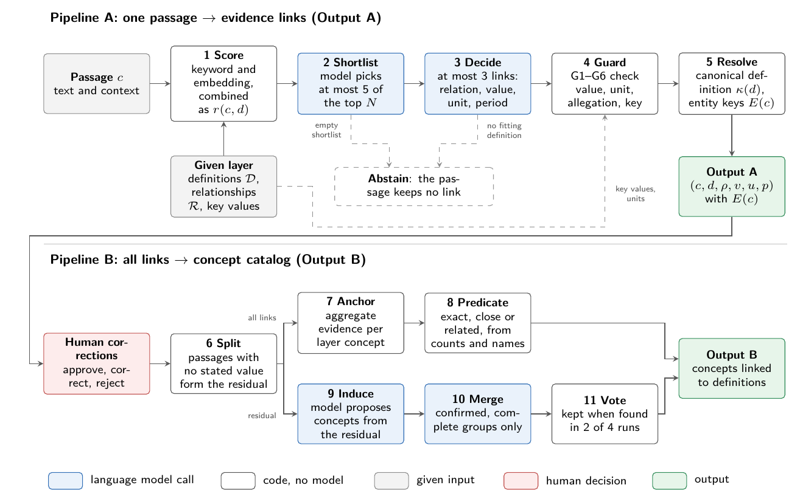

[English](README.md) | 简体中文

# 面向非结构化数据的语义工作区

语义工作区把文档、可填写表单和通话录音映射到一个给定且从不编辑的语义层上。
它产出从段落到定义的证据链接、有锚点的概念目录，以及预定义表的行。
问答工作区读取这些输出，用 SQL 计算每个数字，并引用每个回答背后的段落。

它以 AMP 的形式随附，运行在 Cloudera AI 上。
文档站点：<https://ferdinandzhong.github.io/unstructured-semantic-workspace/zh/>，由 `mkdocs.yml` 和 `docs/` 构建（见[文档](#文档)）。

## 为什么重要

AI 助手和智能体现在处理企业数据。
在受监管的行业中，每个回答都必须能追溯到受治理的定义。
表有这样的基础：语义层为每个字段和指标命名并给出定义，还声明表如何连接。
合同、表单和通话录音没有这样的基础。
它们包含的限额、日期和承诺，无法与表连接，也无法与表一起治理。

本项目把这一缺口看作映射任务。
对每个段落，判断它陈述了哪些定义的值、或与哪些定义相关，或者弃权。
然后把这些证据归并为与语义层相连的业务概念。
这些输出让文档获得与表相同的受治理词汇。

## 论文

**Mapping Unstructured Documents onto a Governed Semantic Layer: Evidence Links and an Anchored Concept Catalog.**
工作草稿，2026 年 11 月 23 日，未经评审。PDF：[`docs/paper/main.pdf`](docs/paper/main.pdf)。

该算法让小型语言模型在检索到的定义中做选择。
关系、值和实体键由代码决定。
语义层的概念通过聚合收集证据；只有无法解释的段落才会进入归纳模型。

- 在留出数据上（金标准集 A2，82 个锚点，运行一次），链接精确率为 0.70，而阈值和规则为 0.29。
- 在未见的合成文档包上，链接精确率最高达到 0.90，误链接率为 0.01。
- 对承诺的召回率仍然是主要限制。
- 建立在这些输出之上的问答路径，在四场未见考试中的任何一场都没有达到通过线（30 题中的 11、14、18 和 17）。

评估集很小，每个集由一位 AI 标注员编写，这些集合覆盖两个演示数据集。

### 如何引用

该论文是没有发表渠道的工作论文。作者：Qishuai Zhong（Cloudera）。

```bibtex
@unpublished{semantic_workspace_2026,
  author = {Zhong, Qishuai},
  title  = {Mapping Unstructured Documents onto a Governed Semantic Layer:
            Evidence Links and an Anchored Concept Catalog},
  note   = {Working paper, draft of 23 November 2026, not reviewed.},
  year   = {2026},
  url    = {https://github.com/FerdinandZhong/unstructured-semantic-workspace}
}
```

## 输入与输出

| | 项目 | 内容 |
| --- | --- | --- |
| 输入 | 结构化数据 | 带行的表，以只读方式载入私有 PostgreSQL |
| 输入 | 语义模型 | 每个数据集一个 Ossie YAML 文件：字段、关系、指标。给定，从不编辑 |
| 输入 | 非结构化来源 | 文档、可填写 XFA 表单和音频，由 SHA-256 固定，每个带一个数据标签 |
| 输入 | 访问策略和人工决定 | 账户、不可见来源、更正、批准、确认、发布版本 |
| 输出 A | 证据链接 | 对每个段落：定义、关系（`states_value_of`、`is_about`、`none`）、值、单位、期间、实体键 |
| 输出 B | 概念目录 | 通过由证据计数计算出的 SKOS 谓词链接到定义的业务概念；作为带版本的 Ossie 发布版本发布 |

论文定义了两个输出，A 和 B。
工作区还把写出表行作为一项系统功能，只在预览和确认之后写入。
见 `docs/output-c.md`。这项功能没有实测的准确率结果。

## 架构


构建时，管线 A 把段落链接到语义模型（输出 A）。
管线 B 把这些证据归并为概念（输出 B）。
由人批准并发布一个发布版本。
提问时，规则优先的路由器把每个请求送到四个固定工具之一；只有当规则无法补全一条操作请求时才由模型协助。



算法的十一个步骤中有四个调用语言模型。其余由代码完成。

## 工作区 UI

每个数据集的步骤相同。

| 步骤 | 作用 |
| --- | --- |
| Sources（数据源） | 上传并处理文档、表单和通话；OCR、表单字段和转写 |
| Model（模型） | 查看语义模型的表和定义 |
| Evidence（证据） | 逐段落审核证据链接；批准、更正或拒绝 |
| Concepts（概念） | 构建概念目录（先预览，再确认）；审核概念及其链接 |
| Publish（发布） | 把已批准的目录作为带版本的发布版本发布 |
| Ask（提问） | 提问；解释术语；预览并确认表写入；列出连接 |
| Entity 360（实体 360） | 每个实体一份只读报告：概况、持仓、证据、概念、比较。仅限金融服务 |

提问会在运行时显示每个请求的各个阶段：路由、理解、计划、查询、读取、决定。
回答包含事实、结论、最多四条引用和摘要，或者包含拒答及其原因。

顶部栏的开关可在英文和简体中文之间切换 UI 语言。
服务器保持英文。标识符、数字和掩码后的值从不翻译。

## 在 Cloudera AI 上部署为 AMP

AMP 创建两个作业和一个应用。它尚未在真实的 Cloudera AI 工作区上运行过。

| 步骤 | 脚本 | 说明 |
| --- | --- | --- |
| 作业 `setup_environment` | `cai/setup_environment.py` | 由 `requirements-v2.lock` 加 `pgserver` 构建 venv；应用副本；AdventureWorks 下载；检查。无提供方调用 |
| 作业 `prepare_demo` | `cai/prepare_demo.py` | 摄取来源并通过实际的 Mistral 调用构建两个目录；约 15 分钟；可续跑 |
| 应用 | `cai/start_app.py` | 在 `CDSW_APP_PORT` 上提供工作区服务 |

要求：Python 3.12 运行时、一个 Mistral API 密钥，每个作业和应用各 2 CPU 和 8 GB。

| 变量 | 是否必需 | 含义 |
| --- | --- | --- |
| `MISTRAL_API_KEY` | 是 | Mistral API 密钥；机密，从不打印 |
| `MISTRAL_OCR_MODEL` | 否 | OCR 模型；默认 `mistral-ocr-latest` |
| `MISTRAL_AUDIO_MODEL` | 否 | 转写模型；清单默认值是 `voxtral-mini-transcribe-3` |
| `DEMO_HOLD_OUT` | 否 | 保持未处理、留待实际摄取的来源键；默认 `MFG-114` |
| `V2_ICEBERG_ROUTE` | 否 | `trino` 通过 Cloudera Lakehouse Engine (Trino) 把已确认的行写入 Iceberg |
| `V2_TRINO_URL` | 否 | Trino 端点的 HTTPS URL |
| `V2_TRINO_CA` | 否 | Trino 端点的 CA 包 |
| `CDE_TOKEN` | 否 | Trino 路径的工作负载令牌；机密 |

启动脚本把 `V2_ALLOWED_HOSTS` 设置为 `semantic-workspace.<CDSW_DOMAIN>`，使服务器接受应用代理的主机。
如果公共主机不同，请自行设置。
演示账户是模拟的，没有密码。请让应用只对项目私有。
文件夹、调优变量和未经测试的内容见 `docs/zh/deployment.md`。

## 在本地运行

在专用环境中使用 Python 3.12。锁文件记录的是经过测试的 macOS arm64 环境。

```bash
uv venv --python 3.12 .venv-v2
uv pip install --python .venv-v2/bin/python -r requirements-v2.lock
.venv-v2/bin/python -B -m pytest tests_v2 -q -p no:cacheprovider          # offline; replays recorded replies
.venv-v2/bin/python -I demo_data/manufacturing/scripts/prepare_data.py     # pinned AdventureWorks tables
```

服务器需要 PostgreSQL 工具 `initdb` 和 `pg_ctl`。用 `--pg-bin` 或 `V2_PG_BIN` 指定它们所在的文件夹。
状态目录必须是仓库之外的绝对路径。

```bash
export MISTRAL_API_KEY=...            # live calls; Mistral receives every processed file
export V2_PG_BIN=/path/to/postgresql/bin
STATE="$HOME/.semantic-workspace-state"
.venv-v2/bin/python -m semantic_pipeline_v2.prepare_demo --state-dir "$STATE"
.venv-v2/bin/python -m semantic_pipeline_v2.workspace_server --state-dir "$STATE" --import-models
```

服务器会打印它的地址。默认端口是 8137；`--port` 可以更改它。
请先运行 `prepare_demo`，再运行服务器：两者都要占用状态目录的同一把锁。
`prepare_demo` 还接受 `--dataset`、`--hold-out SOURCE_ID` 和 `--source`。

## 数据与许可

所有随附数据都是合成的，或带有公开许可。

| 材料 | 标签 | 许可和署名 |
| --- | --- | --- |
| 金融结构化数据：一个模拟银行工作簿，11 张表，2026 年 11 月 4 日至 6 日 | 合成 | 为本项目编写 |
| 金融文档 `FIN-001` 至 `FIN-012`、关于虚构公司的负面媒体和报告文件 | 合成 | 为本项目编写 |
| 根据一幅公开图表制作的评论文档 | 公开 | CC BY-SA 4.0，Wikimedia Commons |
| 关于五个金融概念的 FIBO 定义 | 公开 | MIT，Enterprise Data Management Council |
| 制造表：AdventureWorks OLTP 示例，25 张表 | 公开示例 | MIT，Microsoft；固定提交 `8fe3fd0c9a825fef3ae6d601e97537b612d7b214` |
| 制造合同 `MFG-001` 至 `MFG-007`，文档包 `MFG-101` 至 `MFG-114` | 合成 | 为本项目编写 |
| AdventureWorks 原生文档，文本形式 | 公开示例 | MIT，Microsoft |

公开文件的范围是 `extraction_only`。它们从不被归纳为概念，也从不与实体关联。
用于构建写表功能的清理后的客户表单和通话录音不在本仓库中。
见 `docs/zh/data.md`。

## 限制

- 对承诺的召回率是主要限制。候选清单步骤为许多承诺段落丢掉了正确的定义。
- 在更宽的语料上，目录链接召回率为 0.29。管线 B 只能锚定管线 A 链接的内容。
- 没有任何未见的问答考试达到通过线。
- 评估集很小，且只有一位标注员。对金标准集 A2 和概念集，只有第一次运行是留出的；之后各行是开发数据。
- 写表功能只读取 `docs/output-c.md` 中描述的表单、打印报告、通话和带标签文档的版式。它没有模式编辑器，不给已有的表添加列，也没有准确率测量。
- 批准是已批准的概念影响回答之前的唯一关口。
- AMP 和 Linux 安装未经测试。

## 仓库布局

| 路径 | 内容 |
| --- | --- |
| `semantic_pipeline_v2/` | 服务器、摄取、管线 A 和 B、回答路径、提问运行框架、写入目标 |
| `multimedia_rag/` | 管线导入的、继承而来的切分器和字段模式 |
| `tests_v2/` | 带已记录嵌入和模型答复的离线测试 |
| `docs/design/v2-workspace/` | 工作区 UI 及其语言词典 |
| `demo_data/` | 两个数据集、它们的模型、生成器和来源说明 |
| `cai/` | Cloudera AI 作业和应用脚本 |
| `.project-metadata.yaml` | AMP 清单 |
| `docs/` | 本文档和论文（`docs/paper/`） |
| `requirements-v2.lock` | 固定的 Python 依赖 |

## 文档

```bash
uv venv .venv-docs && uv pip install --python .venv-docs/bin/python -r docs-requirements.txt
.venv-docs/bin/mkdocs build --strict
```

页面：概念、架构、摄取、管线 A、管线 B、审核与发布、提问、表行、
访问与掩码、本地化、评估、数据和部署。

## 许可

许可：Apache License 2.0，见 [`LICENSE`](LICENSE)。第三方数据保留上文列出的各自许可。
