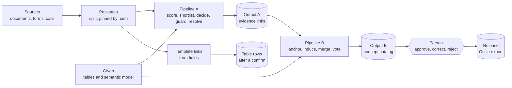
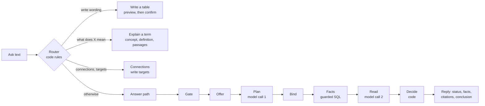
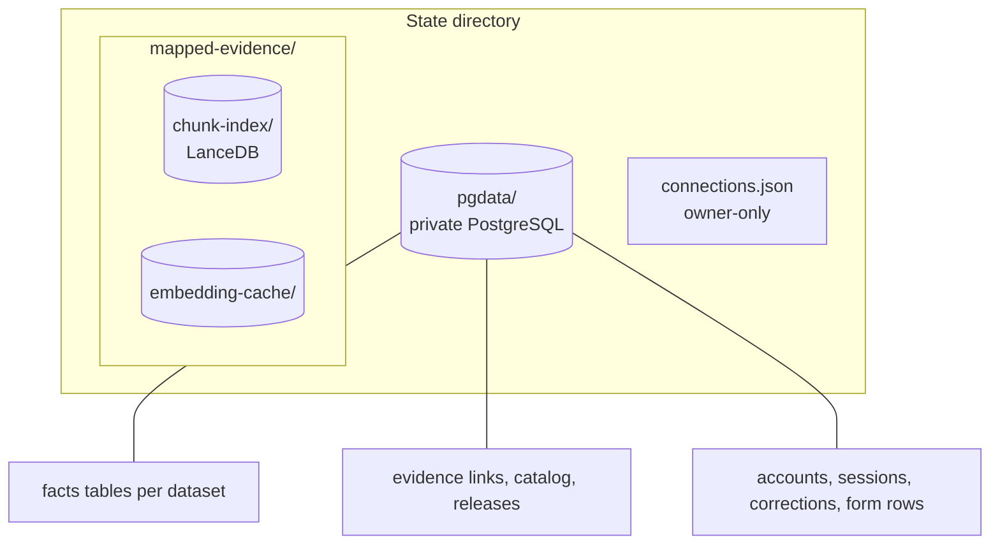

# Architecture

The system has two phases.
At build time it turns sources into evidence links, a concept catalog and a published release.
At question time a small harness routes each request to one fixed tool.
Both phases run in one Python server process with a private PostgreSQL and a local vector index.

*Figure 1 of the paper. The right panel shows one demo question answered from a letter and its amendment.
A refusal replaces the three result parts when no answer is supported.*

## Build time

1. Ingestion turns each source into passages. See [Ingestion](ingestion.md).
2. Pipeline A writes evidence links for each passage. See [Pipeline A](pipeline-a.md).
3. Pipeline B reads all links and writes the concept catalog. See [Pipeline B](pipeline-b.md).
4. A person reviews the links and concepts and publishes a release. See [Review and release](review-and-release.md).
5. For declared form templates, code fills table rows. See [Table rows](output-c.md).

Four of the eleven algorithm steps call a language model. Code does the rest.

## Question time

The router is code first; a model helps only with a request to act that the rules do not complete, and code checks its reply.
It names a tool. It never writes.
The answer path makes one or two model calls.
Code computes every number and selects the citations.
See [Ask](ask.md).

## Components

| Component | Module | Role |
| --- | --- | --- |
| Workspace server | `semantic_pipeline_v2/workspace_server.py` | HTTP routes, sessions, masking at the response boundary, static UI |
| Access | `access.py` | Demo accounts, grants, withheld sources, sessions |
| Ingestion | `ocr.py`, `xfa.py`, `transcribe.py`, `chunk_index.py` | OCR, form fields, transcription, passages and embeddings |
| Pipeline A | `evidence_links.py`, `interpreter.py`, `semantic_retrieval.py` | Candidate retrieval, model decision, guards, entity keys |
| Pipeline B | `concept_catalog.py`, `concept_induction.py` | Anchoring, residual induction, merge, vote |
| Corrections | `catalog_api.py`, `mapping_corrections.py` | Human corrections as appended rows |
| Release | `publish.py` | Versioned Ossie export |
| Form rows | `physical_mapping.py`, `xfa.py` | Table rows from form templates and printed labels |
| Answer path | `answer_path.py`, `metric_sql.py`, `periods.py` | Plan, bind, guarded SQL, read, decide |
| Ask harness | `ask_router.py`, `ask_actions.py`, `answer_detail.py`, `ask_trace.py` | Router, writes, fact handles, progress trace |
| Write targets | `trino_target.py`, `iceberg_target.py`, `connections.py` | Trino write, generated Spark job, connection settings |
| Entity 360 | `entity_report.py` | One report on one entity, read-only |
| Masking | `identifier_mask.py` | Restricted identifiers masked in every JSON reply |
| UI | `docs/design/v2-workspace/` | Workspace shell, pages and dictionaries |

The server uses the Python standard library HTTP server.
It accepts same-origin requests only.
Behind an application proxy, the deployment names the public host. See [Deployment](deployment.md).

## Data stores

All state lives under one state directory outside the repository.

| Store | What it holds |
| --- | --- |
| Private PostgreSQL (`pgdata/`) | Structured facts in schema `v2_facts_<dataset>`; `v2_evidence_links`; `v2_catalog_concept`; `v2_release`; `v2_physical_rows`; accounts and sessions; corrections |
| LanceDB chunk index | One row per chunk: text, position, labels, scope, vector |
| Embedding cache | Vectors keyed by embedding space and text hash |
| `connections.json` | Write-target settings, file mode 0600; secrets are never returned |

The server starts its own PostgreSQL from the binaries named by `--pg-bin` or `V2_PG_BIN`.
A lock file stops two processes from using one state directory.
The server refuses a non-empty state directory that it did not create.

One index never mixes vector spaces.
The embedding model is `mistral-embed` with 1024 dimensions.

## External services

| Service | Used for | Required |
| --- | --- | --- |
| Mistral | OCR, transcription, embeddings, model decisions, induction, answer plans | For ingest, build and answers |
| Cloudera Lakehouse Engine (Trino) | Direct write of table rows to Iceberg | No |
| Cloudera Data Engineering | Generated Spark job for Iceberg | No |
| Semantic Hub | Target format of the release export | No runtime call |

Mistral receives the content of every processed file.
Use only data you may send to that provider.

## Models

| Step | Model |
| --- | --- |
| Embeddings | `mistral-embed` |
| OCR | `mistral-ocr-latest` (default) |
| Transcription | `voxtral-mini-latest` (default) |
| Shortlist and decision (Pipeline A) | `mistral-small-latest`, prompts `shortlist-v2` and `interp-v3` |
| Induction (Pipeline B) | `mistral-small-latest` |
| Merge confirmation (Pipeline B) | `mistral-medium-latest` |
| Answer plan and read | `mistral-small-latest`, selectable by `V2_ANSWER_MODEL` |

## Write rules

- No write reaches a shared table without a preview and a human confirm.
- A confirm needs the preview's fingerprint and a one-use approval.
- Writes from Ask are limited to the administrator.
- Answer results go to insert-only tables, so a replay adds nothing.
