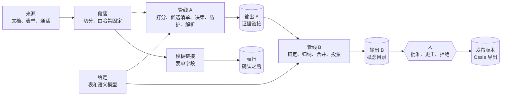
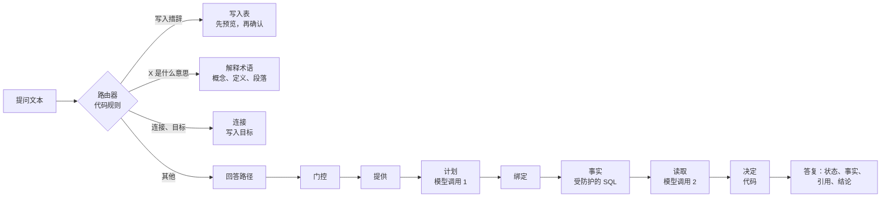
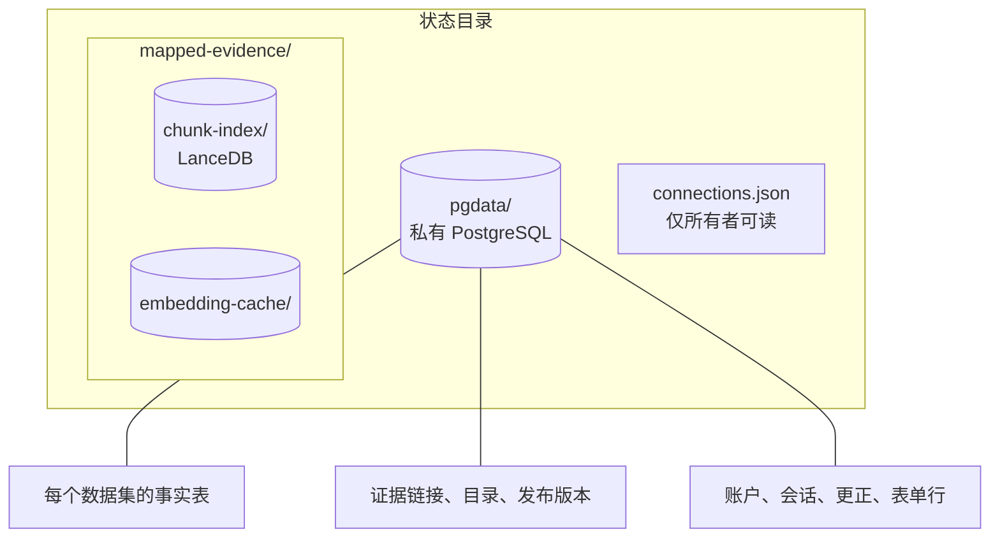

# 架构

系统分两个阶段。
构建时，它把来源变成证据链接、概念目录和已发布的发布版本。
提问时，一个小型运行框架把每个请求路由到一个固定工具。
两个阶段都运行在同一个 Python 服务进程中，使用私有 PostgreSQL 和本地向量索引。

*论文的图 1。右侧面板显示一个演示问题，它由一封信函及其修订函回答。
当没有可支持的回答时，拒答会替换三个结果部分。*

## 构建时

1. 摄取把每个来源变成段落。见[摄取](ingestion.md)。
2. 管线 A 为每个段落写入证据链接。见[管线 A](pipeline-a.md)。
3. 管线 B 读取所有链接并写入概念目录。见[管线 B](pipeline-b.md)。
4. 由人审核链接和概念并发布一个发布版本。见[审核与发布](review-and-release.md)。
5. 对声明的表单模板，代码填写表行。见[表行](output-c.md)。

算法的十一个步骤中有四个调用语言模型。其余由代码完成。

## 提问时

路由器首先是代码；只有当规则无法补全一条操作请求时才由模型协助，并由代码检查其回复。
它指定一个工具。它从不执行写入。
回答路径进行一到两次模型调用。
代码计算每个数字并选择引用。
见[提问](ask.md)。

## 组件

| 组件 | 模块 | 作用 |
| --- | --- | --- |
| 工作区服务器 | `semantic_pipeline_v2/workspace_server.py` | HTTP 路由、会话、响应边界处的掩码、静态 UI |
| 访问 | `access.py` | 演示账户、授权、不可见来源、会话 |
| 摄取 | `ocr.py`, `xfa.py`, `transcribe.py`, `chunk_index.py` | OCR、表单字段、转写、段落和嵌入 |
| 管线 A | `evidence_links.py`, `interpreter.py`, `semantic_retrieval.py` | 候选检索、模型决策、防护规则、实体键 |
| 管线 B | `concept_catalog.py`, `concept_induction.py` | 锚定、残余归纳、合并、投票 |
| 更正 | `catalog_api.py`, `mapping_corrections.py` | 以追加行记录的人工更正 |
| 发布版本 | `publish.py` | 带版本的 Ossie 导出 |
| 表单行 | `physical_mapping.py`, `xfa.py` | 来自表单模板和打印标签的表行 |
| 回答路径 | `answer_path.py`, `metric_sql.py`, `periods.py` | 计划、绑定、受防护的 SQL、读取、决定 |
| 提问运行框架 | `ask_router.py`, `ask_actions.py`, `answer_detail.py`, `ask_trace.py` | 路由器、写入、事实句柄、进度记录 |
| 写入目标 | `trino_target.py`, `iceberg_target.py`, `connections.py` | Trino 写入、生成的 Spark 作业、连接设置 |
| 实体 360 | `entity_report.py` | 针对一个实体的一份报告，只读 |
| 掩码 | `identifier_mask.py` | 在每个 JSON 答复中掩码受限标识符 |
| UI | `docs/design/v2-workspace/` | 工作区外壳、页面和词典 |

服务器使用 Python 标准库的 HTTP 服务器。
它只接受同源请求。
在应用代理之后，部署会指定公共主机。见[部署](deployment.md)。

## 数据存储

所有状态都在仓库之外的一个状态目录下。

| 存储 | 内容 |
| --- | --- |
| 私有 PostgreSQL（`pgdata/`） | 模式 `v2_facts_<dataset>` 中的结构化事实；`v2_evidence_links`；`v2_catalog_concept`；`v2_release`；`v2_physical_rows`；账户和会话；更正 |
| LanceDB 分块索引 | 每个分块一行：文本、位置、标签、范围、向量 |
| 嵌入缓存 | 以嵌入空间和文本哈希为键的向量 |
| `connections.json` | 写入目标设置，文件权限 0600；密钥从不返回 |

服务器用 `--pg-bin` 或 `V2_PG_BIN` 指定的二进制文件启动自己的 PostgreSQL。
锁文件阻止两个进程使用同一个状态目录。
服务器拒绝它自己没有创建的非空状态目录。

一个索引从不混用向量空间。
嵌入模型是 `mistral-embed`，1024 维。

## 外部服务

| 服务 | 用途 | 是否必需 |
| --- | --- | --- |
| Mistral | OCR、转写、嵌入、模型决策、归纳、回答计划 | 摄取、构建和回答时需要 |
| Cloudera Lakehouse Engine (Trino) | 把表行直接写入 Iceberg | 否 |
| Cloudera Data Engineering | 为 Iceberg 生成的 Spark 作业 | 否 |
| Semantic Hub | 发布版本导出的目标格式 | 无运行时调用 |

Mistral 会收到每个已处理文件的内容。
只使用你可以发送给该提供方的数据。

## 模型

| 步骤 | 模型 |
| --- | --- |
| 嵌入 | `mistral-embed` |
| OCR | `mistral-ocr-latest`（默认） |
| 转写 | `voxtral-mini-latest`（默认） |
| 候选清单和决策（管线 A） | `mistral-small-latest`，提示词 `shortlist-v2` 和 `interp-v3` |
| 归纳（管线 B） | `mistral-small-latest` |
| 合并确认（管线 B） | `mistral-medium-latest` |
| 回答计划和读取 | `mistral-small-latest`，可由 `V2_ANSWER_MODEL` 选择 |

## 写入规则

- 没有预览和人工确认，任何写入都不会到达共享表。
- 确认需要预览的指纹和一次性批准。
- 来自提问的写入仅限管理员。
- 回答结果写入只插入的表，因此重放不会增加任何内容。
