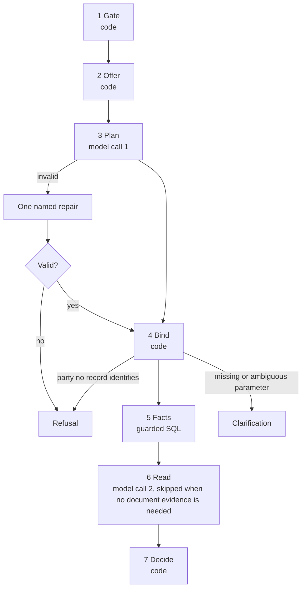

# Ask

Ask is a small harness around the answer path.
Code rules route each text to one of four fixed tools. A model helps only when a request to act is worded in a way the rules do not complete.
The answer path joins SQL facts with cited document clauses.
It makes one or two model calls. Code computes every number and decides the status, the arithmetic and the citations.

## The router

The router is code first.
It names a tool and its arguments. It never runs one.
It checks the rules in this order.

| Order | Tool | Rule |
| --- | --- | --- |
| 1 | Write a table | The text asks to write, save or load, and names a table or the lakehouse. A question is never a write. |
| 2 | Explain a term | The text asks what a term means: "what does X mean", "define X", "meaning of X". |
| 3 | Connections | The text names a connection or a write target. |
| 4 | Answer | Otherwise: a question about the data and documents. |

A polite request such as "can you write this to Iceberg?" counts as a request, not a question.
A write tool only produces a preview. The write itself needs a separate confirm. See [Table rows](output-c.md).

### When the rules are not enough

Some requests to act are worded in a way the rules do not complete, such as "Add report 3 and report 4 to the transactions".
For such a text, and only for it, the router makes one model call. A plain question never causes this call.

- The model receives the fixed tool list, the files this account may read and the declared tables. It replies with one tool and its arguments as JSON.
- Code checks every argument. The tool must be in the list. Each file must be readable. A table must resolve to exactly one declared table.
- The text itself must name each file and the table. If the model picks one the text does not name, the app asks back.
- An unusable reply falls back to the rules. An unclear request gets a clarification that lists the real choices.
- The trace shows how the route was chosen: by the rules, by the model, or by the rules after an unusable model reply.

A write chosen this way is still only a preview.

### Clarifications offer choices

When a request is ambiguous, the app asks back. It does not guess.
If the clarification is a choice among things the semantic layer already knows, the card offers them as buttons.

- Several definitions, concepts, records with the same name, or files match: each is a button with its label and a one-line meaning.
- One definition needs a value from a short set, such as a business date, a currency or a year: the values are buttons.
- The value comes from a large set, such as hundreds of products: the card gives a plain sentence with a few examples.
- The semantic layer offers no real choice: the card shows only the question.

Code builds the choices from the published concepts, the model definitions and the data. No model is called.
A click sends a complete request as the next turn. The person can always type instead.
A choice never shows a value the account may not read, and an account without the write right is refused at once.

The published concepts (Output B) are used when a release exists. Without a release, the choices come from the given semantic model only.

## Chat sessions

A chat session lasts until the user starts a new one. The browser keeps the sessions; the server keeps none.
Each later request carries the last turns as short quoted data.
When a text may lean on earlier turns, one model call rewrites it into a standalone request, for example "and for 2022?".
Code checks that the rewrite keeps every identifier and number of the new text. If the check fails, the text is read as typed.
The answer shows the rewritten request as "Understood as".
Opening a past session shows the stored turns. It sends no request and repeats no write.

The explain tool shows the concept, the definition and the passages from Output B.
The connections tool lists write targets. Secrets stay on the server.

## The answer path

**Input:** a question, the asking principal, the semantic model, the structured data, the readable chunks, Output A, and the approved concepts of the latest release of Output B.
**Output:** the answer.

1. **Gate (code).** The dataset and the model source must be readable by the principal.
2. **Offer (code).** Code lists what the question states and the data can resolve: entities, periods and plain numbers.
   Entities are exact identifiers, names that equal a span of the question in a name column, and keys a referenced document states.
   Periods are parsed, never guessed.
   An approved concept's label or synonym is offered when the question states it.
3. **Plan (model call 1).** A model writes a typed JSON plan: the measure, its aggregate, entities, value filters, time, the answer kind, the document evidence needed, a comparison, and what no definition supports.
   Every id must come from the definitions or the offered items.
   An invalid plan gets one repair that names the broken item. A second invalid plan is a refusal.
4. **Bind (code).** Stated values are linked against the distinct values of their column.
   Entities are placed through declared relationships.
   A missing required parameter is a clarification that names it.
   An ambiguous value is a clarification.
   A party no record identifies is a refusal.
5. **Facts (code).** A guarded SQL compiler computes the facts.
   Joins follow declared many-to-one relationships of up to three hops.
   A distinct count crosses a bridge table from the base table.
   No model supplies a number.
6. **Read (model call 2).** Code ranks clauses from readable sources.
   A model names a clause for each evidence need and copies its value.
   Code checks that the copy is verbatim, parses it, and checks that the clause's document is tied to the named party.
7. **Decide (code).** Code sets the status, does any comparison or arithmetic, writes the conclusion and selects at most four citations.
   The model writes the summary only.

A failed model call is a refusal, never a made-up answer.
A question costs one or two model calls, plus at most one repair each.
The default model is `mistral-small-latest`. `V2_ANSWER_MODEL` selects another.

## Statuses

| Status | Meaning |
| --- | --- |
| answered | Facts, a conclusion and citations |
| clarify | A missing parameter or an ambiguous value; the reply names it |
| refused | No supported answer, or the source is withheld; the reply gives the reason |

A refusal replaces the result parts when no answer is supported.

## The reply

- Status, reason and refusal reason.
- Definitions used.
- Facts with value, SQL and filters.
- At most four citations.
- The conclusion and any comparison, computed by code.
- A summary written by the model.
- The plan.
- The catalog concepts the question named and whether the plan used them.
- A server-held handle per fact.

The reply is returned to the caller. It is not stored.

## Guards added in rounds 3 to 7

Each guard is a mechanism in code, not a word list for one question.
This table shows a selection.

| Mechanism | What it prevents |
| --- | --- |
| One period parser (day, range, month, month end, quarter, half year, year) | Guessed dates; a period read in different ways by different steps |
| Named repair of an invalid plan | An accidental refusal from one malformed plan item |
| A record a cited clause names narrows the measure; never another party's record | An answer about a different account, deal or order |
| Declared joins of up to three hops; a bridge table for a distinct count | Refusal of two-hop questions; double counting through a join |
| Commitment rule: agreeing, committing, promising or certifying sends the question to documents | A recorded figure presented as what a party agreed |
| Withheld-source rule: when only a withheld source holds the answer, refuse as "source withheld" | An answer built from the readable remainder |
| Direction-word rule: "credit" or "debit" binds the one column value it names, or asks | A total that mixes debits and credits |
| Period outside the data: refuse before checking for a missing parameter | A request for a parameter when no parameter can help |
| Reference-token rule: a report, contract or order number no table key holds must be stated by every cited source | A figure from a different report |
| Catalog-name narrowing rules | A reviewed name overriding the model's own name, or a silent choice between two tables |

The paper lists the full set in its answer-guards table.

## Fact handles and detail

Each answer returns an opaque, server-held handle per fact.
The handle is bound to the dataset and the account.
The rows behind a figure, a chart series and a written result table are derived by the server from the compiler's own query.
Only the projection, one removed condition and a grouping change.
No SQL comes from the browser.

## Progress trace

The server records each stage of a request when it starts: route, understand, plan, query, read, decide.
The reply returns the trace. The client can poll it while the request runs.
Recording adds no model call and no query.
A restricted principal's trace names no source beyond what the reply itself says.

## Entity 360

Entity 360 builds a report on one entity on request. It is read-only and finance only.

| Section | Source |
| --- | --- |
| Profile, holdings | Guarded SQL |
| Evidence | Visible links that carry the entity's key |
| Concepts | Concepts whose evidence passages belong to the entity |
| Comparisons | A stated value beside the recorded value, compared by code |
| Summary | Model text; code drops any sentence without a valid citation or with a number or name its cited items do not hold |

The summary check is lexical, so the summary is labelled for review.
Entities keep the key they are known by and are never merged.
A name in a document never resolves to a customer identifier.
The report is not evaluated against a gold set.

## Measured quality

No unseen exam met the pass bar.
Scores were 11, 14, 18 and 17 of 30.
See [Evaluation](evaluation.md).
