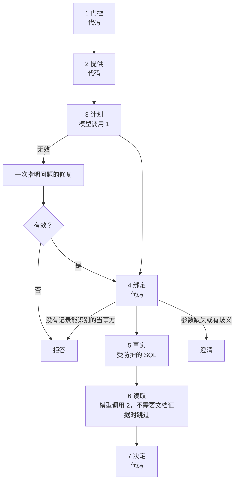

# 提问

提问是围绕回答路径的一个小型运行框架。
代码规则把每段文本路由到四个固定工具之一。只有当一条操作请求的措辞让规则无法补全时，才由模型协助。
回答路径把 SQL 事实与被引用的文档条款结合起来。
它进行一到两次模型调用。代码计算每个数字，并决定状态、算术和引用。

## 路由器

路由器首先是代码。
它指定一个工具及其参数。它从不执行工具。
它按以下顺序检查规则。

| 顺序 | 工具 | 规则 |
| --- | --- | --- |
| 1 | 写入表 | 文本要求写入、保存或加载，并指明一张表或湖仓。问题从不是写入。 |
| 2 | 解释术语 | 文本询问某个术语的含义：“what does X mean”“define X”“meaning of X”。 |
| 3 | 连接 | 文本指明一个连接或一个写入目标。 |
| 4 | 回答 | 其他情况：关于数据和文档的问题。 |

像 “can you write this to Iceberg?” 这样礼貌的说法算作请求，而不是问题。
写入工具只产生预览。写入本身需要单独的确认。见[表行](output-c.md)。

### 规则不够用时

有些操作请求的措辞让规则无法补全，例如 “Add report 3 and report 4 to the transactions”。
对这样的文本，也只对这样的文本，路由器进行一次模型调用。普通问题从不触发这次调用。

- 模型收到固定的工具清单、该账户可读的文件和已声明的表。它以 JSON 回复一个工具及其参数。
- 代码检查每个参数。工具必须在清单内。每个文件必须可读。表必须恰好对应一张已声明的表。
- 文本本身必须指明每个文件和表。如果模型选了文本没有提到的文件或表，应用会反问。
- 无法使用的回复退回到规则。不明确的请求会得到一条列出真实选项的澄清。
- 追踪显示路由是如何选定的：由规则、由模型，或在模型回复不可用后由规则。

这样选定的写入仍然只是预览。

### 澄清时给出选项

当请求含糊时，应用会反问，而不是猜测。
如果澄清只是在语义层已知的几项之间做选择，卡片会把它们列为按钮。

- 多个定义、概念、同名记录或文件相匹配：每一项是一个按钮，带有名称和一行含义。
- 一个定义需要从一个很小的集合中取值，例如业务日期、币种或年份：这些值就是按钮。
- 取值来自很大的集合，例如数百种产品：卡片给出一句说明和几个例子。
- 语义层没有真正可选的项：卡片只显示问题。

选项由代码根据已发布的概念、模型定义和数据生成，不调用模型。
点击会把一条完整的请求作为下一轮发送。用户始终可以自己输入。
选项从不显示该账户无权读取的值；没有写入权限的账户会被立即拒绝。

存在已发布版本时使用已发布的概念（输出 B）。没有已发布版本时，选项只来自给定的语义模型。

## 会话

一个会话持续到用户开启新会话为止。会话保存在浏览器中；服务器不保存。
之后的每个请求都以简短的引用数据携带最近几轮。
当一段文本可能依赖前几轮时，一次模型调用把它改写成独立的请求，例如 “and for 2022?”。
代码检查改写保留了新文本中的每个标识符和数字。检查不通过时，按原文处理。
回答以“理解为”显示改写后的请求。
打开过去的会话只显示已保存的轮次。它不发送请求，也不重复写入。

解释工具显示来自输出 B 的概念、定义和段落。
连接工具列出写入目标。密钥留在服务器上。

## 回答路径

**输入：** 一个问题、提问的主体、语义模型、结构化数据、可读的分块、输出 A，以及输出 B 最新发布版本中已批准的概念。
**输出：** 回答。

1. **门控（代码）。** 主体必须能读取该数据集和模型来源。
2. **提供（代码）。** 代码列出问题陈述且数据可以解析的内容：实体、期间和普通数字。
   实体是精确的标识符、与问题中某一跨度相同的名称列中的名称，以及被引用文档陈述的键。
   期间是解析出来的，从不猜测。
   当问题陈述了已批准概念的标签或同义词时，会提供该名称。
3. **计划（模型调用 1）。** 模型编写一份带类型的 JSON 计划：度量、它的聚合、实体、值过滤、时间、回答类型、所需的文档证据、比较，以及没有定义支持的内容。
   每个 id 都必须来自定义或所提供的项。
   无效的计划会得到一次指明出错项的修复。第二次无效的计划就是拒答。
4. **绑定（代码）。** 陈述的值与其所在列的不同取值相链接。
   实体通过声明的关系放置。
   缺少必需的参数会产生一次指明该参数的澄清。
   有歧义的值会产生一次澄清。
   没有任何记录能识别的当事方会产生一次拒答。
5. **事实（代码）。** 受防护的 SQL 编译器计算事实。
   连接沿着声明的多对一关系，最多三跳。
   去重计数从基表出发穿过桥表。
   没有模型提供数字。
6. **读取（模型调用 2）。** 代码对可读来源的条款排序。
   模型为每个证据需求指出一个条款并复制它的值。
   代码检查复制是否逐字一致，解析该值，并检查该条款的文档是否与所指名的当事方相关联。
7. **决定（代码）。** 代码设定状态，做任何比较或算术，写出结论，并选择最多四条引用。
   模型只写摘要。

失败的模型调用是拒答，从不是编造的回答。
一个问题花费一到两次模型调用，每次最多再加一次修复。
默认模型是 `mistral-small-latest`。`V2_ANSWER_MODEL` 可选择其他模型。

## 状态

| 状态 | 含义 |
| --- | --- |
| answered | 事实、结论和引用 |
| clarify | 缺少参数或值有歧义；答复指明它 |
| refused | 没有可支持的回答，或来源不可见；答复给出原因 |

当没有可支持的回答时，拒答会替换结果部分。

## 答复

- 状态、原因和拒答原因。
- 使用的定义。
- 带值、SQL 和过滤条件的事实。
- 最多四条引用。
- 由代码计算的结论和任何比较。
- 由模型写的摘要。
- 计划。
- 问题提到的目录概念，以及计划是否使用了它们。
- 每个事实一个由服务器持有的句柄。

答复返回给调用方。它不被存储。

## 第 3 至 7 轮加入的防护

每条防护都是代码中的一种机制，不是针对某个问题的词表。
下表给出其中一部分。

| 机制 | 它防止什么 |
| --- | --- |
| 一个期间解析器（日、范围、月、月末、季度、半年、年） | 猜测日期；不同步骤对同一期间的不同解读 |
| 对无效计划的指明式修复 | 因一个畸形的计划项而意外拒答 |
| 被引用条款指名的记录会收窄度量；从不使用另一个当事方的记录 | 回答成另一个账户、交易或订单的情况 |
| 声明的连接最多三跳；去重计数使用桥表 | 拒答两跳问题；因连接造成重复计数 |
| 承诺规则：同意、承诺、保证或证明会把问题送往文档 | 把已记录的数字呈现为当事方同意的内容 |
| 不可见来源规则：当只有不可见来源持有答案时，以“source withheld”拒答 | 用可读的剩余部分拼出回答 |
| 方向词规则：“credit”或“debit”绑定它指明的那个列值，否则就询问 | 混合借方和贷方的总额 |
| 期间超出数据：在检查缺失参数之前拒答 | 在任何参数都无济于事时仍请求参数 |
| 引用标记规则：没有表键持有的报告、合同或订单号，必须由每个被引用的来源陈述 | 来自另一份报告的数字 |
| 目录名称收窄规则 | 已审核的名称覆盖模型自己的名称，或在两张表之间静默选择 |

论文在它的回答防护表中列出了完整集合。

## 事实句柄与明细

每个回答为每个事实返回一个不透明的、由服务器持有的句柄。
句柄绑定到数据集和账户。
数字背后的行、图表系列和写入的结果表，由服务器根据编译器自己的查询导出。
只改变投影、去掉一个条件和一次分组变化。
浏览器不提供任何 SQL。

## 进度记录

服务器在每个阶段开始时记录它：路由、理解、计划、查询、读取、决定。
答复返回这份记录。客户端可以在请求运行时轮询它。
记录不增加模型调用，也不增加查询。
受限主体的记录不指明答复本身所说之外的任何来源。

## 实体 360

实体 360 应请求为一个实体生成一份报告。它是只读的，仅限金融。

| 部分 | 来源 |
| --- | --- |
| 概况、持仓 | 受防护的 SQL |
| 证据 | 带有该实体键的可见链接 |
| 概念 | 证据段落属于该实体的概念 |
| 比较 | 把陈述的值与记录的值并列，由代码比较 |
| 摘要 | 模型文本；代码丢弃任何没有有效引用的句子，或带有其所引用项不包含的数字或名称的句子 |

摘要检查是词法层面的，因此摘要被标注为待审核。
实体保留它们为人所知的键，从不被合并。
文档中的名称从不解析为客户标识符。
该报告没有对照金标准集评估。

## 测得的质量

没有任何未见考试达到通过线。
得分是 30 题中的 11、14、18 和 17。
见[评估](evaluation.md)。
