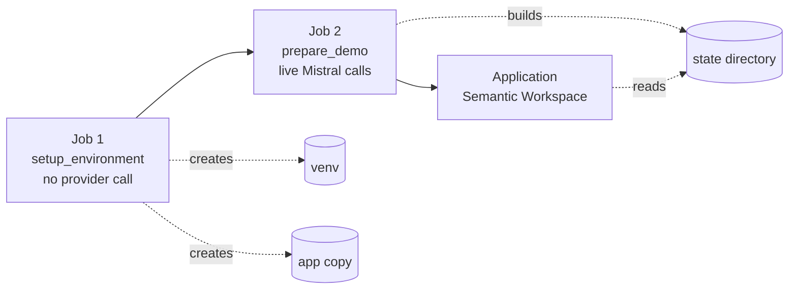

# Deployment

The workspace ships as an AMP for Cloudera AI.
The AMP creates two jobs and one application.
The jobs build a Python environment and the demo state. The application serves the workspace.

!!! warning "Untested on a real workspace"
    The AMP has not yet run on a real Cloudera AI workspace.
    The dependency lock records a tested macOS arm64 environment. Linux installation is untested.
    The public-host setting for the application proxy is an assumption until it runs.

## What the AMP creates

| Step | Script | What it does | Resources |
| --- | --- | --- | --- |
| Job `setup_environment` | `cai/setup_environment.py` | Installs `requirements-v2.lock` and `pgserver` into a venv; copies the code to an app folder; downloads the pinned AdventureWorks sample and builds its tables; checks the PostgreSQL tools and the imports | 2 CPU, 8 GB, 45 min timeout |
| Job `prepare_demo` | `cai/prepare_demo.py` | Ingests the registered sources of both datasets and builds each concept catalog | 2 CPU, 8 GB, 90 min timeout |
| Application `Semantic Workspace` | `cai/start_app.py` | Serves the workspace on `CDSW_APP_PORT` with the private PostgreSQL of the demo state | 2 CPU, 8 GB |

The runtime is a Workbench editor with a Python 3.12 kernel.

`setup_environment` calls no provider. It is safe to rerun. Rerun it after a `git pull`.
`prepare_demo` is resumable. It takes about 15 minutes.
Stop the application before a rerun of `prepare_demo`, because the state has one lock.

## Folders

All folders sit under `/home/cdsw`, the only folder that jobs and the application share.

| Folder | Holds |
| --- | --- |
| `/home/cdsw` | The AMP checkout |
| `/home/cdsw/.venv-semantic-workspace` | The venv |
| `/home/cdsw/.semantic-workspace-app` | The app copy the jobs and the application run from |
| `/home/cdsw/.semantic-workspace-state` | Private PostgreSQL, evidence index, catalog, connections |

The app copy exists for one reason.
The server refuses a state folder inside the repository, and on Cloudera AI the repository is `/home/cdsw` itself.

### The state directory

| Path | Holds |
| --- | --- |
| `pgdata/` | The private PostgreSQL data directory |
| `mapped-evidence/chunk-index/` | The LanceDB chunk index |
| `mapped-evidence/embedding-cache/` | Cached embeddings |
| `connections.json` | Write-target settings, owner-only |

PostgreSQL 16 comes from the `pgserver` wheel. It needs no root and no Docker.
Without the PostgreSQL tools, the server still starts, read-only, without review, evidence or answers.

## Environment variables

### Declared in the AMP manifest

| Variable | Required | Default | Meaning |
| --- | --- | --- | --- |
| `MISTRAL_API_KEY` | Yes | — | Mistral API key. A secret. Never printed. |
| `MISTRAL_OCR_MODEL` | No | `mistral-ocr-latest` | OCR model |
| `MISTRAL_AUDIO_MODEL` | No | `voxtral-mini-transcribe-3` | Transcription model for audio uploads. The code default, when unset, is `voxtral-mini-latest`. |
| `DEMO_HOLD_OUT` | No | `MFG-114` | Comma-separated source keys that `prepare_demo` leaves new for a live ingest. Empty prepares every source. |
| `V2_ICEBERG_ROUTE` | No | empty | `trino` writes confirmed rows to Iceberg through Cloudera Lakehouse Engine (Trino) |
| `V2_TRINO_URL` | No | empty | HTTPS URL of the Trino endpoint |
| `V2_TRINO_CA` | No | empty | CA bundle for the Trino endpoint, inside the project |
| `CDE_TOKEN` | No | empty | Workload token (JWT) for the Trino route. A secret. Never printed. |

### Injected by Cloudera AI

| Variable | Use |
| --- | --- |
| `CDSW_APP_PORT` | The application port. The server binds the loopback address on it. Local default: 8137. |
| `CDSW_DOMAIN` | With the subdomain `semantic-workspace`, it gives the public host |

### Set by the launch scripts

| Variable | Use |
| --- | --- |
| `V2_PG_BIN` | Folder of the PostgreSQL tools from `pgserver` |
| `V2_ALLOWED_HOSTS` | Public host names the server accepts in the `Host` header |

### Optional tuning, read by the code

| Variable | Default | Meaning |
| --- | --- | --- |
| `V2_ANSWER_MODEL` | `mistral-small-latest` | Answer plan and read model |
| `V2_INTERPRETER_MODEL` | `mistral-small-latest` | Pipeline A decision model |
| `V2_INTERPRET_PROMPT` | `interp-v3` | Pipeline A decision prompt |
| `V2_CANDIDATE_VARIANT` | `two_step` | Candidate method |
| `V2_SHORTLIST_POOL` | 60 | First-step list size |
| `V2_WHOLE_CATALOG_MAX` | 150 | Catalog size at or below which the whole catalog is offered |
| `V2_SHORTLIST_EXTRA` | 0 | Extra candidates added to a shortlist |
| `V2_INTERPRET_WORKERS` | 4 | Parallel decision calls |
| `V2_MAX_LINKED_CHUNKS` | 256 | Chunks interpreted per source |
| `V2_FIELD_PASSAGES` | on | `0` turns field passages off |
| `V2_ASK_CATALOG` | `published` | Any other value stops answers from reading the published catalog |

## Proxy host setting

The server accepts same-origin requests only.
Behind the Cloudera AI application proxy, the browser uses the application's public host.
The server must know that host.

`cai/start_app.py` builds `V2_ALLOWED_HOSTS` from any hosts already listed plus `semantic-workspace.<CDSW_DOMAIN>`.
It prints the result at start.
If the public host differs, set `V2_ALLOWED_HOSTS` to the right name in the project settings.
`SEMANTIC_WORKSPACE_SUBDOMAIN` changes the subdomain part.

## Provider traffic

Mistral receives the content of every processed file.
`prepare_demo` sends the registered sources of both datasets.
The application sends uploaded files, passages for links and questions for answers.

## Access

The demo accounts are simulated. They have no passwords.
Keep the application private to the project.
See [Access and masking](access-and-masking.md).

## Optional Iceberg write

With `V2_ICEBERG_ROUTE=trino`, `V2_TRINO_URL` and `CDE_TOKEN` set, a confirmed write also goes to Iceberg through Trino.
The generated Spark job is then for download only.
See [Table rows](output-c.md).

The Cloudera Data Engineering connection can also be set in the workspace, in `connections.json`.
Sign-in by access key exchanges a key pair for a workload token with the `cdp` CLI.
That exchange has not been run against a live service.

## What is untested

| Item | Status |
| --- | --- |
| The AMP on a real Cloudera AI workspace | Not yet run |
| Linux installation of the lock file | Untested |
| Public host from `CDSW_DOMAIN` | Assumed |
| Sign-in by access key | Not run against a live service |
| Spark job write to Iceberg | Submitted twice in one environment; refused by the catalog |
| Trino write to Iceberg | Run live in one environment |
