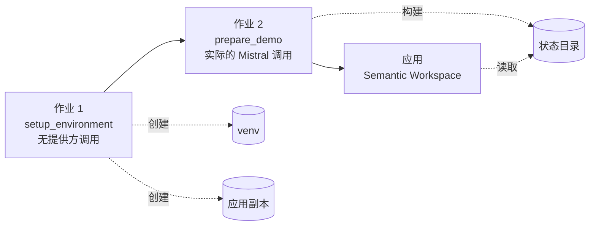

# 部署

工作区以 AMP 的形式随附，运行在 Cloudera AI 上。
AMP 创建两个作业和一个应用。
作业构建 Python 环境和演示状态。应用提供工作区服务。

!!! warning "未在真实工作区上测试"
    AMP 尚未在真实的 Cloudera AI 工作区上运行过。
    依赖锁文件记录的是经过测试的 macOS arm64 环境。Linux 安装未经测试。
    应用代理的公共主机设置在运行之前只是一个假设。

## AMP 创建什么

| 步骤 | 脚本 | 作用 | 资源 |
| --- | --- | --- | --- |
| 作业 `setup_environment` | `cai/setup_environment.py` | 把 `requirements-v2.lock` 和 `pgserver` 安装到 venv；把代码复制到应用文件夹；下载固定的 AdventureWorks 示例并构建它的表；检查 PostgreSQL 工具和导入 | 2 CPU、8 GB、45 分钟超时 |
| 作业 `prepare_demo` | `cai/prepare_demo.py` | 摄取两个数据集的已注册来源，并构建每个概念目录 | 2 CPU、8 GB、90 分钟超时 |
| 应用 `Semantic Workspace` | `cai/start_app.py` | 在 `CDSW_APP_PORT` 上提供工作区服务，使用演示状态的私有 PostgreSQL | 2 CPU、8 GB |

运行时是带 Python 3.12 内核的 Workbench 编辑器。

`setup_environment` 不调用任何提供方。可以安全地重新运行。在 `git pull` 之后请重新运行它。
`prepare_demo` 可以续跑。它大约需要 15 分钟。
重新运行 `prepare_demo` 之前请停止应用，因为状态只有一把锁。

## 文件夹

所有文件夹都在 `/home/cdsw` 之下，它是作业和应用共享的唯一文件夹。

| 文件夹 | 内容 |
| --- | --- |
| `/home/cdsw` | AMP 检出目录 |
| `/home/cdsw/.venv-semantic-workspace` | venv |
| `/home/cdsw/.semantic-workspace-app` | 作业和应用运行所用的应用副本 |
| `/home/cdsw/.semantic-workspace-state` | 私有 PostgreSQL、证据索引、目录、连接 |

应用副本的存在只有一个原因。
服务器拒绝位于仓库内部的状态文件夹，而在 Cloudera AI 上仓库就是 `/home/cdsw` 本身。

### 状态目录

| 路径 | 内容 |
| --- | --- |
| `pgdata/` | 私有 PostgreSQL 数据目录 |
| `mapped-evidence/chunk-index/` | LanceDB 分块索引 |
| `mapped-evidence/embedding-cache/` | 缓存的嵌入 |
| `connections.json` | 写入目标设置，仅所有者可读 |

PostgreSQL 16 来自 `pgserver` wheel。它不需要 root，也不需要 Docker。
没有 PostgreSQL 工具时，服务器仍然启动，但是只读，没有审核、证据或回答。

## 环境变量

### 在 AMP 清单中声明

| 变量 | 是否必需 | 默认值 | 含义 |
| --- | --- | --- | --- |
| `MISTRAL_API_KEY` | 是 | — | Mistral API 密钥。是机密。从不打印。 |
| `MISTRAL_OCR_MODEL` | 否 | `mistral-ocr-latest` | OCR 模型 |
| `MISTRAL_AUDIO_MODEL` | 否 | `voxtral-mini-transcribe-3` | 音频上传的转写模型。未设置时，代码默认值是 `voxtral-mini-latest`。 |
| `DEMO_HOLD_OUT` | 否 | `MFG-114` | 以逗号分隔的来源键，`prepare_demo` 会让它们保持未处理，留待实际摄取。为空则准备每个来源。 |
| `V2_ICEBERG_ROUTE` | 否 | 空 | `trino` 通过 Cloudera Lakehouse Engine (Trino) 把已确认的行写入 Iceberg |
| `V2_TRINO_URL` | 否 | 空 | Trino 端点的 HTTPS URL |
| `V2_TRINO_CA` | 否 | 空 | Trino 端点的 CA 包，位于项目内 |
| `CDE_TOKEN` | 否 | 空 | Trino 路径的工作负载令牌（JWT）。是机密。从不打印。 |

### 由 Cloudera AI 注入

| 变量 | 用途 |
| --- | --- |
| `CDSW_APP_PORT` | 应用端口。服务器在其上绑定回环地址。本地默认值：8137。 |
| `CDSW_DOMAIN` | 与子域 `semantic-workspace` 一起给出公共主机 |

### 由启动脚本设置

| 变量 | 用途 |
| --- | --- |
| `V2_PG_BIN` | 来自 `pgserver` 的 PostgreSQL 工具所在文件夹 |
| `V2_ALLOWED_HOSTS` | 服务器在 `Host` 头中接受的公共主机名 |

### 可选调优，由代码读取

| 变量 | 默认值 | 含义 |
| --- | --- | --- |
| `V2_ANSWER_MODEL` | `mistral-small-latest` | 回答计划和读取模型 |
| `V2_INTERPRETER_MODEL` | `mistral-small-latest` | 管线 A 决策模型 |
| `V2_INTERPRET_PROMPT` | `interp-v3` | 管线 A 决策提示词 |
| `V2_CANDIDATE_VARIANT` | `two_step` | 候选方法 |
| `V2_SHORTLIST_POOL` | 60 | 第一步列表大小 |
| `V2_WHOLE_CATALOG_MAX` | 150 | 目录大小不超过此值时，提供整个目录 |
| `V2_SHORTLIST_EXTRA` | 0 | 加入候选清单的额外候选 |
| `V2_INTERPRET_WORKERS` | 4 | 并行决策调用 |
| `V2_MAX_LINKED_CHUNKS` | 256 | 每个来源解读的分块数 |
| `V2_FIELD_PASSAGES` | 开启 | `0` 关闭字段段落 |
| `V2_ASK_CATALOG` | `published` | 任何其他值都会使回答不再读取已发布的目录 |

## 代理主机设置

服务器只接受同源请求。
在 Cloudera AI 应用代理之后，浏览器使用应用的公共主机。
服务器必须知道该主机。

`cai/start_app.py` 用已列出的任何主机加上 `semantic-workspace.<CDSW_DOMAIN>` 构建 `V2_ALLOWED_HOSTS`。
它在启动时打印结果。
如果公共主机不同，请在项目设置中把 `V2_ALLOWED_HOSTS` 设置为正确的名称。
`SEMANTIC_WORKSPACE_SUBDOMAIN` 更改子域部分。

## 提供方流量

Mistral 会收到每个已处理文件的内容。
`prepare_demo` 发送两个数据集的已注册来源。
应用发送上传的文件、用于链接的段落和用于回答的问题。

## 访问

演示账户是模拟的。它们没有密码。
请让应用只对项目私有。
见[访问与掩码](access-and-masking.md)。

## 可选的 Iceberg 写入

设置了 `V2_ICEBERG_ROUTE=trino`、`V2_TRINO_URL` 和 `CDE_TOKEN` 后，已确认的写入也会通过 Trino 写入 Iceberg。
此时生成的 Spark 作业只供下载。
见[表行](output-c.md)。

Cloudera Data Engineering 的连接也可以在工作区中设置，位于 `connections.json`。
通过访问密钥登录，会用 `cdp` CLI 把密钥对换成工作负载令牌。
该交换尚未对实际服务运行过。

## 未经测试的内容

| 项目 | 状态 |
| --- | --- |
| 真实 Cloudera AI 工作区上的 AMP | 尚未运行 |
| 锁文件的 Linux 安装 | 未测试 |
| 来自 `CDSW_DOMAIN` 的公共主机 | 假设 |
| 通过访问密钥登录 | 未对实际服务运行 |
| 通过 Spark 作业写入 Iceberg | 在一个环境中提交两次；被目录拒绝 |
| 通过 Trino 写入 Iceberg | 在一个环境中实际运行 |
