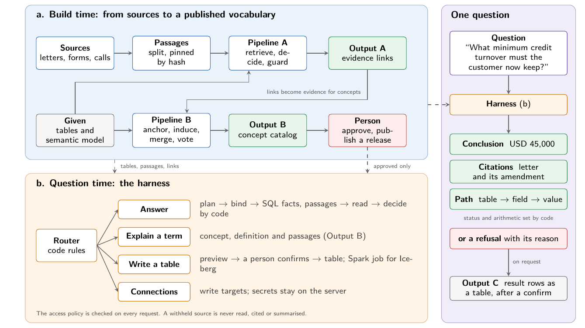

# 语义工作区

**把文档、表单和通话录音，纳入您的表已经拥有的语义层。**

语义工作区把非结构化来源链接到受治理的语义模型。
随后它可以跨表和文档回答问题，每个回答都带有引用。
它被打包为面向 Cloudera AI 的 Applied ML Prototype（AMP）。

-   **链接**

    文档的每个段落都被链接到它所涉及的字段或度量，并带上它陈述的值。

-   **归组**

    已链接的证据被归组为业务概念目录，由人审核并发布。

-   **提问**

    用自然语言提问。数字来自 SQL，措辞来自被引用的段落。

-   **写入**

    表单、报告和通话中陈述的值，经过预览和确认后，写成 Iceberg 表的行。

## 背景

企业对表的治理已经很成熟。
语义层为每个字段和度量命名、给出定义，并声明表如何连接。
Text-to-SQL 工具和仪表板都建立在这一层之上。

但大部分业务知识在表之外。
合同里有限额和承诺，表单里有上报的交易，通话录音里有客户的原话。
这些内容都没有语义层。

只靠检索补不上这个缺口。
检索返回的是段落，而不是含义。
它没有记录一个条款给出了哪个字段的值、针对哪个客户或订单，也没有记录它是陈述了这个值还是只在讨论它。
因此，合同里的交货日期无法与订单表比较，表上的访问规则也管不到文档。

## 思路

语义工作区把现有的语义层作为目标。
它不在旁边另建一套模型，也从不修改这套语义层。

- **文档加入您已经在治理的模型。** 证据链接把段落挂到模型的字段和度量上。
- **业务词汇从证据中生长。** 概念先锚定在模型上；只有模型无法解释的部分才被提议为新概念。
- **由人掌控。** 人来批准、更正或拒绝。只有已发布的版本才会进入回答。
- **一套访问策略。** 读者无权查看的来源，绝不会为该读者读取、引用或摘要。

## 工作方式

*系统概览。(a) 构建阶段把来源变成证据链接和概念目录。(b) 提问阶段把每个请求路由到四个固定工具之一。右栏跟随一个问题，直到带引用的回答。*

### 构建阶段

1. **摄取。** PDF、可填写表单、音频和文本变成段落。每个段落以哈希固定到它的来源。
2. **链接（Pipeline A）。** 一个小型语言模型在检索出的定义中做选择。随后由代码检查陈述的值、确定关系并附上实体键。
3. **归组（Pipeline B）。** 模型已有的概念通过汇总收集证据。只有剩余部分才交给模型提议新概念。
4. **审核与发布。** 审核人批准、更正或拒绝。发布把结果固定为一个带版本的文件，供 Semantic Hub 使用。

### 提问阶段

每个请求进入四个工具之一：回答问题、解释术语、写入表，或列出连接。
工具由代码规则选择。只有当一条操作请求的措辞让规则无法补全时，才由模型协助。

- **回答是计算出来的，不是生成出来的。** 受防护的 SQL 编译器计算每个数字。模型负责规划查询和读取条款中的值。
- **每个回答都给出依据。** 答复列出使用的定义、带过滤条件的事实，以及最多四条被引用的段落。
- **不猜测，而是反问。** 含糊的请求会得到一次澄清，选项来自语义层中的真实内容。
- **追问保留上下文。** 一个聊天会话带着前几轮，所以“那 2022 年呢？”可以直接问。

## 设计原则

整个设计贯穿一条原则：**模型选择，代码判定。**

语言模型只用在必须读懂语言的地方：选择定义、提议概念、规划问题。
凡是必须精确、可重复的决定，都由确定性的代码完成：值、数字、状态、引用和访问。
这样结果可以解释，也可以审计。

## 您得到什么

| 结果 | 它是什么 | 谁使用它 |
| --- | --- | --- |
| **证据链接** | 段落到定义的链接，带关系、值、单位、期间和实体键 | 审核人、回答路径 |
| **概念目录** | 链接到模型的业务概念，带版本，作为发布版本发布 | 数据管理员、Semantic Hub |
| **表行** | 陈述的值通过 Cloudera Lakehouse Engine (Trino) 写入已声明的 Iceberg 表 | 数据工程师、分析师 |
| **带引用的回答** | 每个问题一个答复，带事实、引用和所走的路径 | 业务用户 |

## 为治理而设计

- **合成数据和公开样例数据**随 AMP 提供。您配置的模型服务只会收到交给它处理的内容。
- **标识符掩码**对无权查看的读者隐藏账号和客户 ID。
- **写入需要人来确认。** 每次写入都先显示预览，并需要单独确认。
- **支持英文和简体中文**界面，也可以用任一语言提问。

## 基于 Cloudera 平台

- **Cloudera AI** 以 AMP 的形式承载应用及其作业。
- **Cloudera Lakehouse Engine (Trino)** 是把表行直接写入 Iceberg 的路径。
- **Semantic Hub** 是发布导出的目标：一个通过其模式检查和 lint 的 Ossie 文件。

## 两个现成的示例

| 数据集 | 结构化数据 | 非结构化来源 |
| --- | --- | --- |
| 金融服务 | 一份模拟银行工作簿，11 张表，143 条定义 | 合成的银行文档、可填写表单和一段通话录音 |
| 制造业 | AdventureWorks 样例数据，25 张表，240 条定义 | 合成合同和 AdventureWorks 样例文档 |

哪些是合成的、哪些是公开的以及署名，见[数据](data.md)。

## 接下来读什么

**了解设计**

1. [概念](concepts.md)：任务、术语和词汇表。
2. [架构](architecture.md)：构建阶段、提问阶段、组件和数据存储。
3. [摄取](ingestion.md)：每种文件类型如何变成段落。
4. [管线 A](pipeline-a.md)：从段落到证据链接。
5. [管线 B](pipeline-b.md)：从证据链接到概念目录。
6. [审核与发布](review-and-release.md)：人的决定，以及什么会进入回答。

**使用与运维**

- [提问](ask.md)：路由器、聊天会话、澄清、回答和引用。
- [表行](output-c.md)：把陈述的值写入 Iceberg。
- [访问与掩码](access-and-masking.md)：账户、不可见的来源和标识符掩码。
- [本地化](localization.md)：英文和中文的语言切换。
- [部署](deployment.md)：Cloudera AI 上的 AMP。

**深入了解**

- [评估](evaluation.md)：实测结果及各自的适用范围。
- 工作论文 *Mapping Unstructured Documents onto a Governed Semantic Layer: Evidence Links and an Anchored Concept Catalog*：
  [`docs/paper/main.pdf`](https://github.com/FerdinandZhong/unstructured-semantic-workspace/blob/main/docs/paper/main.pdf)。
