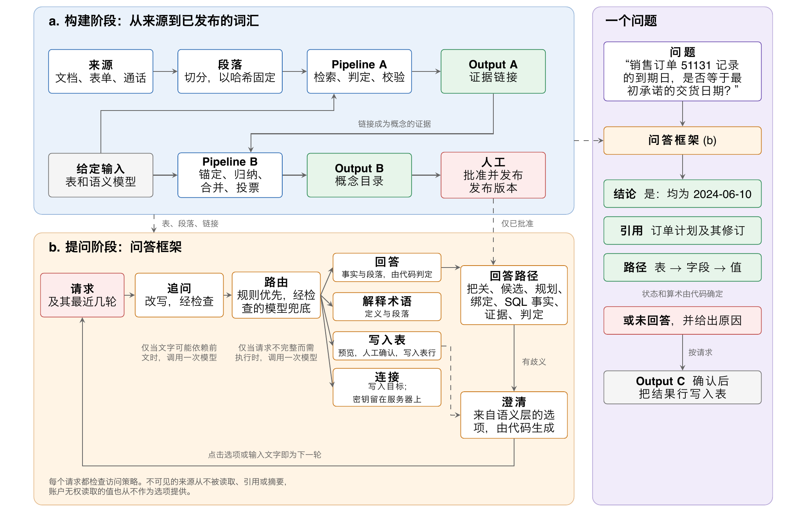

# 语义工作区

语义工作区把非结构化来源映射到一个给定且从不编辑的语义层上。
来源包括文档、可填写表单和通话录音。
结果是证据链接和有锚点的概念目录。
工作区还可以把写出表行作为一项系统功能，论文没有涉及它。
问答工作区读取这些结果，并引用每个回答背后的段落。

本站介绍设计和细节。
内容来自工作论文和代码。
本站不含实验练习。

*论文的图 1。
(a) 构建时，管线 A 把段落链接到给定的语义模型（输出 A）。
管线 B 把这些证据归并为概念（输出 B）。
由人批准并发布一个发布版本。
(b) 提问时，规则优先的路由器把每个请求送到四个固定工具之一；只有当规则无法补全一条操作请求时才由模型协助。*

## 为什么需要它

结构化数据有语义层。
语义层为每个字段和指标命名并给出定义，还声明表如何连接。
合同、表单和通话录音没有这样的层。
它们包含的限额、日期和承诺，无法与表连接，也无法与表一起治理。

论文把这一缺口看作映射任务。
对每个段落，判断它陈述了哪些定义的值、或与哪些定义相关，或者弃权。
然后把这些证据归并为与语义层相连的业务概念。
语义层是目标。系统从不编辑它。

## 规则

整个设计遵循一条规则：模型选择，代码决定。

- 小型语言模型在检索到的定义中做选择。
- 确定性防护规则检查陈述的值、确定关系并附加实体键。
- 语义层的概念通过聚合收集证据，不调用模型。
- 只有语义层无法解释的段落才会进入归纳模型。
- 提问时，代码计算每个数字。模型编写计划并读取条款中的值。

## 主要结果与限制

论文报告了以下结果。每个结果的适用范围是结论的一部分。

| 结果 | 数值 | 范围 |
| --- | --- | --- |
| 链接精确率，模型决策步骤 | 0.70 | 留出的金标准集 A2，运行一次，82 个锚点 |
| 链接精确率，阈值和规则 | 0.29 | 同一数据集 |
| 未见数据包上的精确率，两步法 | 0.73（金融），0.90（制造） | 生成器制作的合成数据包，运行一次 |
| 未见数据包上的误链接率，两步法 | 0.03（金融），0.01（制造） | 同样的数据包 |
| 问答，未见考试 | 30 题中的 11、14、18 和 17 | 四场考试；没有一场达到通过线 |

!!! warning "论文声明的限制"
    对承诺的召回率是主要限制。
    评估集很小，每个集由一位 AI 标注员编写。
    这些集合覆盖两个演示数据集。
    问答路径在任何未见考试上都未达到通过线。
    论文不声称达到最先进水平。

每张表及其范围见[评估](evaluation.md)。

## 阅读指南

按以下顺序阅读设计部分。

1. [概念](concepts.md)：任务、术语和词汇表。
2. [架构](architecture.md)：构建时、提问时、组件和数据存储。
3. [摄取](ingestion.md)：每种文件类型如何变成段落。
4. [管线 A](pipeline-a.md)：从段落到证据链接。
5. [管线 B](pipeline-b.md)：从证据链接到概念目录。
6. [审核与发布](review-and-release.md)：人工决定，以及什么会进入回答。

使用和运维部分请阅读以下页面。

- [提问](ask.md)：问答路径、路由器、拒答和引用。
- [表行](output-c.md)：来自表单、打印报告、通话和文档的表行，以及两条写入路径。
- [访问与掩码](access-and-masking.md)：账户、不可见来源和标识符掩码。
- [本地化](localization.md)：英文和中文的语言切换。
- [部署](deployment.md)：Cloudera AI 上的 AMP。
- [数据](data.md)：两个示例数据集及其许可。

## 论文

*Mapping Unstructured Documents onto a Governed Semantic Layer: Evidence Links and an Anchored Concept Catalog.*
工作草稿，2026 年 11 月 23 日，未经评审。
PDF 在仓库中，路径为
[`docs/paper/main.pdf`](https://github.com/FerdinandZhong/unstructured-semantic-workspace/blob/main/docs/paper/main.pdf)。

## 两个数据集

工作区自带两个演示数据集。

| 数据集 | 结构化数据 | 非结构化来源 |
| --- | --- | --- |
| Financial Services（金融服务） | 一个模拟银行工作簿，11 张表，三天的交易 | 合成的银行文档、可填写表单、一段通话录音 |
| Manufacturing（制造） | AdventureWorks 示例数据，25 张表 | 合成合同和 AdventureWorks 示例文档 |

金融模型有 143 个定义。
制造模型有 240 个定义。
哪些是合成数据、哪些是公开数据以及署名，见[数据](data.md)。

## 本站使用的术语

- **Cloudera AI** 以 AMP 的形式托管应用及其作业。
- **Cloudera Lakehouse Engine (Trino)** 是把表行直接写入 Iceberg 的路径。
- **Semantic Hub** 是发布版本导出的目标。发布版本是通过 Semantic Hub 模式检查和 lint 的 Ossie 文件。
