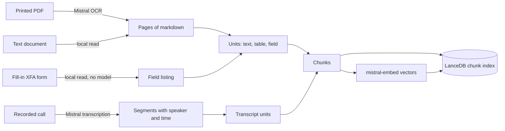

# Ingestion

Ingestion turns each source into passages.
Each source is a file pinned by its SHA-256 hash.
Each passage keeps its source, its revision and its span.
The ingest route is `/api/ocr`. It has three readers: `ocr`, `xfa-fields` and `text`.



## Printed PDF

The OCR reader sends the file to Mistral OCR.
The default model is `mistral-ocr-latest`. `MISTRAL_OCR_MODEL` overrides it.
A document may be at most 12 MiB.

OCR returns page markdown.
It returns the tables of a page apart from the page text.

### Field passages

Printed label-and-value reports needed one change.
The splitter read only the page text.
One report therefore became a single chunk with no link.

Field passages put the tables back.
Each labelled field becomes one passage, written as `Label: value`.
Its section heading becomes its context.
A heading-only passage is recorded without a model call.

The decision uses layout only, never a name or a title.

- A two-column table qualifies when every label cell is bold.
- A text block qualifies when at least three lines hold a short label, three or more spaces, and a value in one shared column.
- A short line between blank lines in such a block becomes a heading.

Field passages are on by default. `V2_FIELD_PASSAGES=0` turns them off.
Every other source keeps identical chunks.

On one printed report, field passages changed 1 chunk with no link into 20 chunks with 13 links.
That figure is the implementer's reading. No gold set scores it.

## Fill-in form

A fill-in XFA form holds its populated data in an embedded data packet.
The `xfa-fields` reader reads that packet locally. No model sees the form at this step.
It rejects a document type definition in the packet.

Each populated field becomes one line:

```text
xfa:data/<group>[1]/<field>[1] = "<value>"
```

The field path keeps the field name and its position.
A value with line breaks still takes one line.

### Template rows

For a document type with a declared template, field names drive table rows.
A form field whose name equals a declared column yields a link with relation `states_value_of`.
The link is recorded as a template link, method `template:<type>`, not as a model interpretation.
These links feed [table rows](output-c.md).

Template links share the evidence-link store with model links.
Sources matched by a template are not sent to concept induction.

## Recorded call

The transcription reader sends the audio to Mistral.
The default model is `voxtral-mini-latest`. `MISTRAL_AUDIO_MODEL` overrides it.
The request asks for speaker separation and segment timestamps.
A media file may be at most 25 MiB.
A transcript may hold at most 1500 segments.

Each segment becomes one unit with:

- the text,
- the speaker label,
- the start and end time in seconds,
- the language.

Chunks keep the speaker and the time.
A citation of a call therefore points to a speaker and a time range.
Transcription takes no other options and no other reader.

## Text document

Markdown and plain-text documents are read as text.
They follow the same splitter as OCR page text.

## From units to chunks

Units are text, table, field or transcript units.
Text units run through the inherited splitter.
A table is never split.
A field unit is one chunk.

Each chunk records:

| Field | Meaning |
| --- | --- |
| order | Position in the source |
| page | First page of the chunk |
| start and end seconds | Time range, for calls |
| speaker | Speakers of the chunk, for calls |
| element kind | text, table, field or transcript |
| references | Spans in the source text |

The chunk context is the title, the nearest heading and, for calls, the speaker.
Pipeline A queries with the passage text joined to this context.

## Embedding

Chunks are embedded with `mistral-embed`, 1024 dimensions, in batches of 16.
The vector column may be empty, because an embedding call can fail.
An embedding-space manifest pins the model, the dimension and the purpose.
One index never mixes vector spaces.

Definition cards are embedded in the same space.
An embedding cache keys each vector by space and text hash.
On a new state, the card embeddings took 37 s and 110 s in two measured runs.
These timings are the implementer's.

## Limits per source

| Setting | Default | Variable |
| --- | --- | --- |
| Chunks interpreted per source | 256 | `V2_MAX_LINKED_CHUNKS` |
| Parallel decision calls | 4 workers | `V2_INTERPRET_WORKERS` |
| Field passages | on | `V2_FIELD_PASSAGES` |

## What leaves the process

Mistral receives the content of every processed file.
The XFA reader is the exception for the read itself. It runs locally.
Template links need no model call.

!!! note "Public files"
    Public files keep scope `extraction_only`.
    They are linked to definitions.
    They are never induced into concepts and never attached to an entity.
