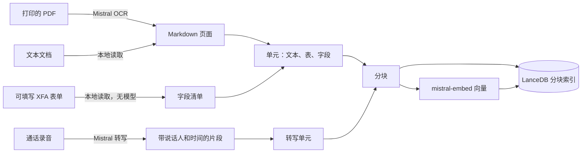

# 摄取

摄取把每个来源变成段落。
每个来源是一个由 SHA-256 哈希固定的文件。
每个段落保留它的来源、修订版本和跨度。
摄取路由是 `/api/ocr`。它有三个读取器：`ocr`、`xfa-fields` 和 `text`。



## 打印的 PDF

OCR 读取器把文件发送给 Mistral OCR。
默认模型是 `mistral-ocr-latest`。`MISTRAL_OCR_MODEL` 可以覆盖它。
一份文档最大为 12 MiB。

OCR 返回页面的 Markdown。
它把页面中的表与页面文本分开返回。

### 字段段落

打印的“标签加值”报告需要一处改动。
切分器只读取页面文本。
因此一份报告变成了一个没有链接的分块。

字段段落把表放回去。
每个带标签的字段成为一个段落，写作 `Label: value`。
它的小节标题成为它的上下文。
只有标题的段落不经模型调用直接记录。

判断只使用版面，从不使用名称或标题。

- 当每个标签单元格都是粗体时，双列表符合条件。
- 当至少三行包含短标签、三个或更多空格，以及位于同一列的值时，文本块符合条件。
- 这类块中位于空行之间的短行成为标题。

字段段落默认开启。`V2_FIELD_PASSAGES=0` 将其关闭。
其他所有来源的分块保持不变。

在一份打印报告上，字段段落把 1 个没有链接的分块变成了 20 个分块和 13 条链接。
这个数字是实现者的读数。没有金标准集对它打分。

## 可填写表单

可填写 XFA 表单把已填写的数据保存在嵌入的数据包中。
`xfa-fields` 读取器在本地读取该数据包。这一步没有模型看到表单。
它会拒绝数据包中的文档类型定义。

每个已填写的字段成为一行：

```text
xfa:data/<group>[1]/<field>[1] = "<value>"
```

字段路径保留字段名和它的位置。
带换行的值仍然只占一行。

### 模板行

对于有声明模板的文档类型，字段名驱动表行。
名称与某个声明的列相同的表单字段，产生一条关系为 `states_value_of` 的链接。
该链接被记录为模板链接，方法为 `template:<type>`，而不是模型解读。
这些链接为[表行](output-c.md)提供数据。

模板链接与模型链接共用证据链接存储。
被模板匹配的来源不会送去做概念归纳。

## 通话录音

转写读取器把音频发送给 Mistral。
默认模型是 `voxtral-mini-latest`。`MISTRAL_AUDIO_MODEL` 可以覆盖它。
请求要求说话人分离和片段时间戳。
一个媒体文件最大为 25 MiB。
一份转写最多可有 1500 个片段。

每个片段成为一个单元，包含：

- 文本，
- 说话人标签，
- 以秒为单位的开始和结束时间，
- 语言。

分块保留说话人和时间。
因此对通话的引用会指向一个说话人和一个时间范围。
转写不接受其他选项，也没有其他读取器。

## 文本文档

Markdown 和纯文本文档按文本读取。
它们使用与 OCR 页面文本相同的切分器。

## 从单元到分块

单元分为文本、表、字段或转写单元。
文本单元通过继承的切分器处理。
表从不被切分。
一个字段单元就是一个分块。

每个分块记录：

| 字段 | 含义 |
| --- | --- |
| order | 在来源中的位置 |
| page | 分块的起始页 |
| start and end seconds | 时间范围，用于通话 |
| speaker | 分块的说话人，用于通话 |
| element kind | text、table、field 或 transcript |
| references | 来源文本中的跨度 |

分块的上下文是标题、最近的小标题，对通话来说还有说话人。
管线 A 用段落文本加上这一上下文来查询。

## 嵌入

分块用 `mistral-embed` 嵌入，1024 维，每批 16 个。
向量列可以为空，因为嵌入调用可能失败。
嵌入空间清单固定模型、维度和用途。
一个索引从不混用向量空间。

定义卡在同一空间中嵌入。
嵌入缓存以空间和文本哈希为每个向量建键。
在一个新状态上，两次测量运行中定义卡的嵌入分别用了 37 秒和 110 秒。
这些耗时是实现者的数据。

## 每个来源的限制

| 设置 | 默认值 | 变量 |
| --- | --- | --- |
| 每个来源解读的分块数 | 256 | `V2_MAX_LINKED_CHUNKS` |
| 并行决策调用 | 4 个工作线程 | `V2_INTERPRET_WORKERS` |
| 字段段落 | 开启 | `V2_FIELD_PASSAGES` |

## 离开进程的内容

Mistral 会收到每个已处理文件的内容。
XFA 读取器是读取本身的例外。它在本地运行。
模板链接不需要模型调用。

!!! note "公开文件"
    公开文件保持范围 `extraction_only`。
    它们会被链接到定义。
    它们从不被归纳为概念，也从不附加到实体。
