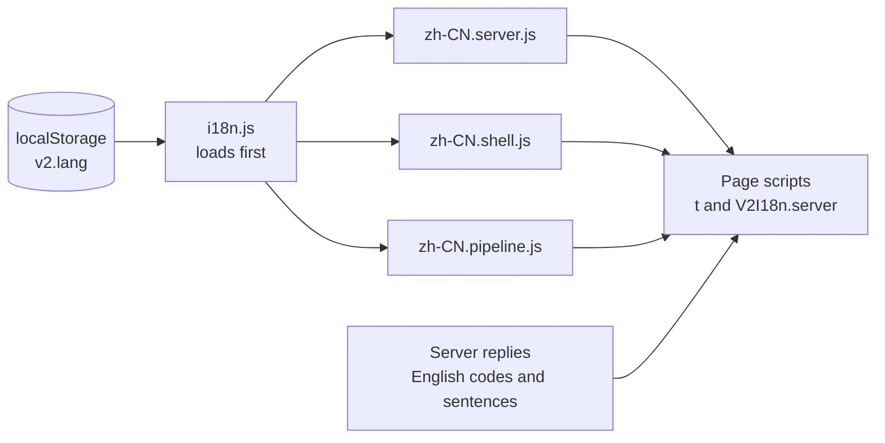

# Localization

The workspace UI shows English or Simplified Chinese.
English is the default.
A switch in the top bar stores the choice and reloads the page.
The server keeps its English text. The browser translates what it shows.

## Design

`i18n.js` loads before any page script.
It reads the choice from `localStorage['v2.lang']`. The values are `en` and `zh-CN`.
It sets the `lang` attribute of the document.
The dictionary files register after it, one area per file.

If storage is blocked, the page uses English, and a new choice lasts for that page only.

## API

| Call | Returns |
| --- | --- |
| `t(key, vars)` | The fixed text in the current language. A missing entry returns the English key. |
| `V2I18n.server(text)` | Text the server sent (a code, a label or a sentence), in Chinese or as sent |
| `V2I18n.number(n, options)` | `Intl.NumberFormat` for the current language; `en-GB` for English |
| `V2I18n.setLang(code)` | Stores the choice and reloads the page |
| `V2I18n.register(lang, entries)` | Adds dictionary entries |

React pages import `t` and `serverText` from `app/src/lib.js`.
They call them at render time, not at module load.

## Key convention

The English source text is the key: `t('Confirm write')`.
Call sites stay readable. English needs no dictionary.

- A sentence with values is one key with named placeholders: `t('{count} rows in {table}', {count, table})`.
- Never build a sentence from translated fragments. Word order differs in Chinese.
- Long sentences are keys too, word for word as English shows them.
- Avoid plurals. When English needs them, choose the key by count.

## Server text

The server sends English codes and sentences.
`V2I18n.server` looks each one up.

1. An exact key match returns its Chinese entry.
2. A key with `{name}` placeholders is also a pattern. It matches a sentence with any text in each placeholder.
3. Chinese is used only when a key matches. Otherwise the text is shown as sent.

So a new server sentence never breaks the page. It shows in English until a dictionary entry exists.

## What is never translated

- Identifiers, ids, file names, table and column names, SQL, numbers, dates, units and masked values.
- Product names: Cloudera, Cloudera AI, Iceberg, Trino, Spark, PostgreSQL, Semantic Hub.
- `data-*` attribute values, CSS class names, `aria-*` ids, route hashes, option values.
- Anything code compares: a reason code, a status, a step key.

Code compares the English value and translates only where the text is shown.
For example, a refusal reason stays `no supported answer` in code.

## Markup safety

Only text nodes are translated.
Markup never passes through a dictionary entry.
Inline markup inside a sentence uses a placeholder, built in code.
Every user or data value is escaped before it reaches a placeholder.
Attribute text is translated the same way and then escaped.

## Dictionary files

| File | Area |
| --- | --- |
| `i18n/zh-CN.server.js` | Server codes and sentences; holds the glossary |
| `i18n/zh-CN.shell.js` | The workspace shell |
| `i18n/zh-CN.pipeline.js` | The React pages |

Each file holds one call: `window.V2I18n?.register('zh-CN', { ... })`.
The object is strict JSON.
One area per file means parallel work never edits one shared file.

A new dictionary file must be added in two places:

- `index.html`, after `i18n.js`;
- `ASSETS` in `semantic_pipeline_v2/workspace_server.py`.

A server started before a file joined `ASSETS` returns 404 for it.
That page keeps English. `workspace.js` defines an English fallback when `i18n.js` is missing.

## Glossary

The glossary heads `zh-CN.server.js`. Every file uses its terms.

| English | Chinese |
| --- | --- |
| evidence link | 证据链接 |
| concept catalog | 概念目录 |
| semantic layer | 语义层 |
| release | 发布版本 |
| passage | 段落 |
| restricted reader | 受限读者 |

## Masking and Chinese text

Identifier masking uses ASCII character classes.
An identifier written next to Chinese text with no space still stands as a token and is masked.
See [Access and masking](access-and-masking.md).
