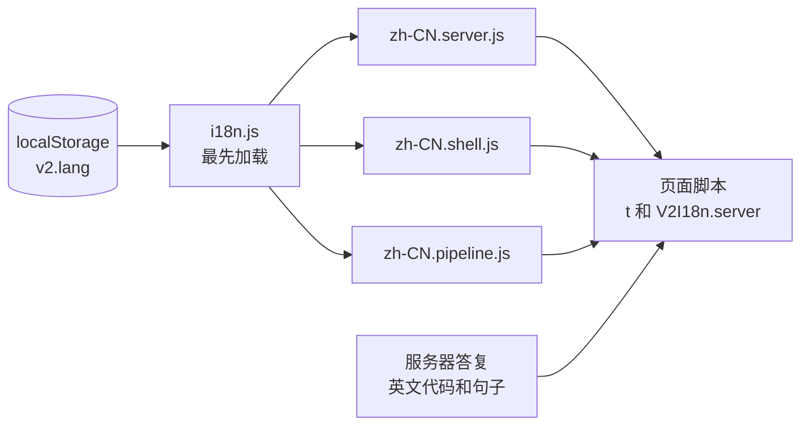

# 本地化

工作区 UI 显示英文或简体中文。
英文是默认值。
顶部栏的开关会保存选择并重新加载页面。
服务器保持它的英文文本。浏览器翻译它显示的内容。

## 设计

`i18n.js` 在任何页面脚本之前加载。
它从 `localStorage['v2.lang']` 读取选择。取值是 `en` 和 `zh-CN`。
它设置文档的 `lang` 属性。
词典文件在它之后注册，每个文件一个区域。

如果存储被阻止，页面使用英文，新的选择只对当前页面有效。

## API

| 调用 | 返回 |
| --- | --- |
| `t(key, vars)` | 当前语言的固定文本。缺少条目时返回英文键。 |
| `V2I18n.server(text)` | 服务器发送的文本（代码、标签或句子），有中文则为中文，否则原样返回 |
| `V2I18n.number(n, options)` | 当前语言的 `Intl.NumberFormat`；英文使用 `en-GB` |
| `V2I18n.setLang(code)` | 保存选择并重新加载页面 |
| `V2I18n.register(lang, entries)` | 添加词典条目 |

React 页面从 `app/src/lib.js` 导入 `t` 和 `serverText`。
它们在渲染时调用，而不是在模块加载时。

## 键约定

英文源文本就是键：`t('Confirm write')`。
调用点保持可读。英文不需要词典。

- 带值的句子是一个带命名占位符的键：`t('{count} rows in {table}', {count, table})`。
- 从不用翻译后的片段拼句子。中文的词序不同。
- 长句子也是键，与英文显示的完全一致。
- 避免复数。当英文需要复数时，按数量选择键。

## 服务器文本

服务器发送英文代码和句子。
`V2I18n.server` 逐个查找它们。

1. 精确匹配键时返回它的中文条目。
2. 带有 `{name}` 占位符的键也是模式。它匹配每个占位符处为任意文本的句子。
3. 只有键匹配时才使用中文。否则按所发送的原样显示文本。

因此，新的服务器句子从不会破坏页面。在词典条目出现之前，它以英文显示。

## 从不翻译的内容

- 标识符、id、文件名、表名和列名、SQL、数字、日期、单位和掩码后的值。
- 产品名称：Cloudera、Cloudera AI、Iceberg、Trino、Spark、PostgreSQL、Semantic Hub。
- `data-*` 属性值、CSS 类名、`aria-*` id、路由哈希、选项值。
- 代码要比较的任何内容：原因代码、状态、步骤键。

代码比较英文值，只在显示文本的地方翻译。
例如，拒答原因在代码中仍然是 `no supported answer`。

## 标记安全

只翻译文本节点。
标记从不经过词典条目。
句子内部的行内标记使用占位符，由代码构建。
每个用户值或数据值在到达占位符之前都会被转义。
属性文本以同样方式翻译，然后转义。

## 词典文件

| 文件 | 区域 |
| --- | --- |
| `i18n/zh-CN.server.js` | 服务器代码和句子；包含词汇表 |
| `i18n/zh-CN.shell.js` | 工作区外壳 |
| `i18n/zh-CN.pipeline.js` | React 页面 |

每个文件包含一次调用：`window.V2I18n?.register('zh-CN', { ... })`。
该对象是严格的 JSON。
每个文件一个区域，意味着并行工作从不编辑同一个共享文件。

新的词典文件必须在两处添加：

- `index.html`，放在 `i18n.js` 之后；
- `semantic_pipeline_v2/workspace_server.py` 中的 `ASSETS`。

在某个文件加入 `ASSETS` 之前启动的服务器，对它返回 404。
该页面保持英文。当 `i18n.js` 缺失时，`workspace.js` 定义一个英文回退。

## 词汇表

词汇表位于 `zh-CN.server.js` 的开头。每个文件都使用其中的术语。

| 英文 | 中文 |
| --- | --- |
| evidence link | 证据链接 |
| concept catalog | 概念目录 |
| semantic layer | 语义层 |
| release | 发布版本 |
| passage | 段落 |
| restricted reader | 受限读者 |

## 掩码与中文文本

标识符掩码使用 ASCII 字符类。
紧挨着中文文本、中间没有空格的标识符，仍然是一个标记，并会被掩码。
见[访问与掩码](access-and-masking.md)。
