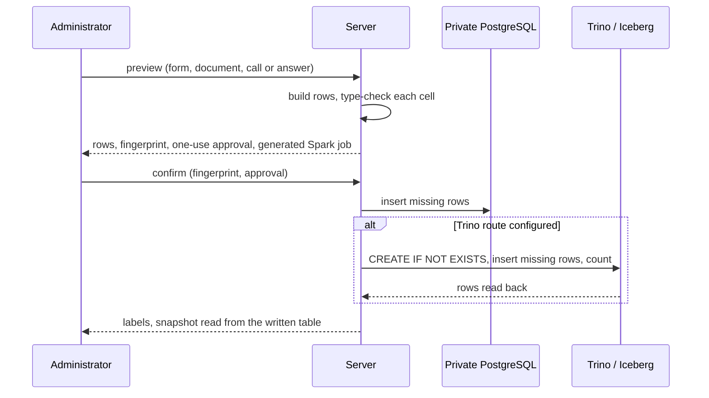

# Table rows

The workspace can write table rows from documents, forms and recorded calls.
This is a system feature.
The paper defines two outputs, A (evidence links) and B (the concept catalog), and does not cover it.
The feature has no measured accuracy result.

Every write needs a preview and an explicit confirm.
Rows are insert-only, so a replay adds nothing.

## Four source shapes

| Source | What it does | Target |
| --- | --- | --- |
| Fill-in form | A form field whose name equals a declared column yields a cell | A declared table |
| Printed report | A printed label maps to a declared column through a label map; a label with no mapping is left out | The same declared tables |
| Recorded call | One row per approved stated value, keyed by the customer identifier the call states | A long table, `ext_call_fact` |
| Document with no declared table | A table proposed from the document's own labels | A new table, `ext_<name>` |

### Fill-in forms

A form field is matched to a declared column by its exact name.
The match yields a link with relation `states_value_of` and method `template:<type>`.
It is recorded as a template link, not as a model interpretation.
An empty field states nothing and yields no cell.

The demo finance model declares two tables.

| Table | Notes |
| --- | --- |
| `STR_Transaction` | The transaction group of a form |
| `STR_AccountEntity` | Account columns; no identity number, name or contact column |

The two tables join on the source revision.

### Printed reports

A printed report states label-and-value pairs, such as "Account number: ...".
A label map in code names, for each declared column, the label that states it and how to read the value.
A label with no entry in the map is left out.
The map in the code covers one report layout.
Another layout needs its own map.

### Recorded calls

The long table has one row per approved stated value.
Its columns are `customer_id`, `field`, `definition`, `value`, `unit`, `period`, `passage`, `source_file` and `chunk_id`.
Only links a person approved or corrected count.
The call must state exactly one customer identifier among its approved links, or the preview is refused.

### A table proposed from a document

When no declared table fits a document, the workspace can propose a table from the labels the document prints.
The document needs at least three labelled fields.

- Each label becomes a column.
- Code infers the column type: date, money, integer, decimal, otherwise text.
- A value that looks like a number but has a leading zero stays text.
- A field whose label names an identifier (number, no, id, reference, code) stays text.
- The table name is `ext_doc_` plus the document title and a short fingerprint of its column names.
- The same labels give the same table, so a later file appends to it.
- A file with other labels is refused by name, and no column is added to an existing table.

## Several sources in one write

One preview can name up to 20 sources.
The server suggests other readable sources whose evidence links or labels fill the same tables.
Code decides the group by comparing the tables each source fills.
A model then writes one sentence, the hint, on why the suggested files fit.
The model sees file, table and field names only.
A failed or odd reply drops the sentence and keeps the suggestion.
The hint is labelled as AI-written.

## Answer results

An answer result can also be written as a table.
It goes to an insert-only table in schema `v2_ask` of the private PostgreSQL.

## Preview and confirm

- The preview is read-only.
- When the Trino route is configured, the preview also asks the lakehouse to validate the insert, without running it.
  A table the lakehouse will refuse shows as a warning before any confirm. A table that does not exist yet is not a refusal.
  A check that cannot run says nothing; the confirm still reports its own result.
- Each cell is type-checked. A value that fails the column's type or unit check is `rejected` and not written.
- A confirm needs the preview's fingerprint and its one-use approval.
- The approval expires after 10 minutes.
- Writes are limited to the administrator.
- A correction made after a preview makes it stale. The confirm then refuses until a new preview.

Each stored cell keeps its source, revision, chunk id and quoted span in `v2_physical_rows`.
The stored cell holds the masked value of an identity number.

After a confirm, the reply holds a snapshot read from the written table itself.
It shows the row count, the number of new rows and the first rows.

## The two write paths to Iceberg

The local private PostgreSQL write is the default. It always runs first.
Two routes reach Iceberg.
The Spark script is always generated and is always available for download.

=== "Direct, through Trino"

    The server writes the same tables, columns and rows through Cloudera Lakehouse Engine (Trino).
    It runs under the platform user's own rights.

    For each table it runs three statements:

    1. `CREATE TABLE IF NOT EXISTS`.
    2. `INSERT ... SELECT ... WHERE NOT EXISTS` on one combined key per row.
    3. A count of the rows now present, read back through Trino.

    Each statement is safe to repeat, so a dropped connection is retried.
    Every table and column name must be a plain identifier.
    Every value is a quoted literal.

    The route is on only when all of these hold:

    | Variable | Meaning |
    | --- | --- |
    | `V2_ICEBERG_ROUTE` | Must be `trino` |
    | `V2_TRINO_URL` | Base URL of the Trino endpoint |
    | `CDE_TOKEN` | A bearer token; the Trino user is the token's subject |
    | `V2_TRINO_CA` | Optional CA file for TLS verification |

    With this route the Spark job is generated for download only.

=== "Generated Spark job"

    Every preview also generates the Cloudera Data Engineering Spark job that would write the same rows to Iceberg.
    The job holds a PySpark script, a job specification and a submit command line with credential placeholders.

    The job creates the tables if missing.
    It runs an insert-only `MERGE` keyed on source id, revision and row key.
    It then checks the row count.
    The catalog credential is referenced as a workload secret in the job specification.
    No credential appears in the specification, the script or the response.

    The reply labels the job "Spark job generated, not submitted" unless it is really submitted.
    No job id, status or count is invented.

### Which route runs

| Configuration | What a confirm does |
| --- | --- |
| Trino route set | Local write, then Trino write; Spark job offered for download |
| Iceberg connection set, preview named Iceberg, no Trino route | Local write, then the Spark job is submitted |
| Neither | Local write; Spark job generated, not submitted |

A failure after the local write is reported. The local write is never rolled back.

## The insert-only rule

A replay must add nothing.
The local table has a unique key on dataset, source revision, table and row key.
The Trino insert compares one combined key per row.

The combined key exists for a reason.
An earlier condition used several null-safe comparisons over a multi-row value list.
The engine returned too few matches, and a replay inserted one duplicate row.
The condition now compares one combined key.

## Limits

- There is no schema editor. A proposed table keeps the name and columns the code gives it.
- A table that exists with other columns is refused. Columns are never added to it.
- The workspace reads only the layouts described above. Other layouts give no rows.
- The label map covers one printed report layout.
- No accuracy is measured for these routes.
