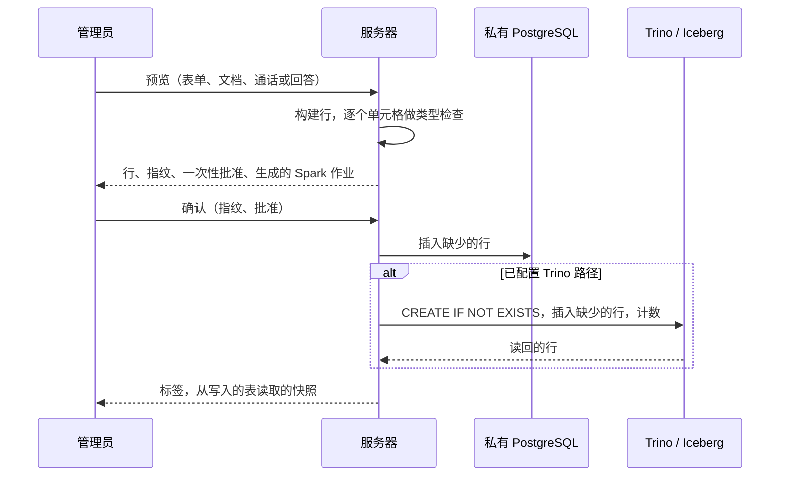

# 表行

工作区可以从文档、表单和通话录音写出表行。
这是一项系统功能。
论文定义了两个输出，A（证据链接）和 B（概念目录），并不涉及这项功能。
这项功能没有实测的准确率结果。

每次写入都需要预览和明确的确认。
行是只插入的，因此重放不会增加任何内容。

## 四种来源形态

| 来源 | 作用 | 目标 |
| --- | --- | --- |
| 可填写表单 | 名称与某个声明的列相同的表单字段产生一个单元格 | 一张声明的表 |
| 打印报告 | 打印的标签通过标签映射对应到声明的列；没有映射的标签被略去 | 同样的声明的表 |
| 通话录音 | 每个已批准的陈述值一行，以通话陈述的客户标识符为键 | 一张长表 `ext_call_fact` |
| 没有声明的表的文档 | 根据文档自己的标签提出一张表 | 一张新表 `ext_<name>` |

### 可填写表单

表单字段按其确切名称与声明的列匹配。
匹配产生一条关系为 `states_value_of`、方法为 `template:<type>` 的链接。
它被记录为模板链接，而不是模型解读。
空字段不陈述任何内容，不产生单元格。

演示金融模型声明了两张表。

| 表 | 说明 |
| --- | --- |
| `STR_Transaction` | 表单的交易组 |
| `STR_AccountEntity` | 账户列；没有身份号码、姓名或联系方式列 |

这两张表在来源修订版本上连接。

### 打印报告

打印报告陈述“标签：值”形式的配对，例如“Account number: ...”。
代码中的标签映射为每个声明的列指明陈述它的标签，以及如何读取值。
映射中没有条目的标签被略去。
代码中的映射只覆盖一种报告版式。
另一种版式需要它自己的映射。

### 通话录音

长表每个已批准的陈述值一行。
它的列是 `customer_id`、`field`、`definition`、`value`、`unit`、`period`、`passage`、`source_file` 和 `chunk_id`。
只有经人批准或更正的链接才计入。
通话在其已批准的链接中必须恰好陈述一个客户标识符，否则预览被拒绝。

### 根据文档提出的表

当没有声明的表适合某份文档时，工作区可以根据该文档打印的标签提出一张表。
文档至少需要三个带标签的字段。

- 每个标签成为一列。
- 代码推断列的类型：日期、金额、整数、小数，否则为文本。
- 看起来像数字但带前导零的值保持为文本。
- 标签表示标识符（number、no、id、reference、code）的字段保持为文本。
- 表名是 `ext_doc_` 加文档标题和其列名的一个短指纹。
- 标签相同则表相同，因此之后的文件追加到该表。
- 标签不同的文件按名称被拒绝，并且不会给已有的表添加列。

## 一次写入多个来源

一次预览最多可以指定 20 个来源。
服务器会建议其他可读的来源，它们的证据链接或标签填写同样的表。
分组由代码决定，方法是比较每个来源填写的表。
然后模型写一句提示，说明建议的文件为什么适合。
模型只看到文件名、表名和字段名。
失败或异常的答复会丢掉这句话，建议仍然保留。
提示被标为由 AI 撰写。

## 回答结果

回答结果也可以作为表写入。
它写入私有 PostgreSQL 的模式 `v2_ask` 中的一张只插入的表。

## 预览与确认

- 预览是只读的。
- 配置了 Trino 路径时，预览还会让湖仓验证这次插入，但不执行。
  湖仓会拒绝的表会在任何确认之前显示为警告。尚不存在的表不算拒绝。
  无法运行的检查什么也不说；确认仍会报告它自己的结果。
- 每个单元格都做类型检查。未通过该列类型或单位检查的值被标为 `rejected`，不写入。
- 确认需要预览的指纹和它的一次性批准。
- 批准在 10 分钟后过期。
- 写入仅限管理员。
- 预览之后进行的更正会使它过期。此后确认会被拒绝，直到有新的预览。

每个存储的单元格在 `v2_physical_rows` 中保留它的来源、修订版本、分块 id 和引用的跨度。
存储的单元格保存的是身份号码的掩码值。

确认之后，答复包含从写入的表本身读取的快照。
它显示行数、新增行数和前几行。

## 写入 Iceberg 的两条路径

写入本地私有 PostgreSQL 是默认方式。它总是先运行。
有两条路径到达 Iceberg。
Spark 脚本总是会生成，并且总是可以下载。

=== "直接，通过 Trino"

    服务器通过 Cloudera Lakehouse Engine (Trino) 写入相同的表、列和行。
    它以平台用户自己的权限运行。

    对每张表，它运行三条语句：

    1. `CREATE TABLE IF NOT EXISTS`。
    2. 在每行一个组合键上执行 `INSERT ... SELECT ... WHERE NOT EXISTS`。
    3. 通过 Trino 读回现在存在的行数。

    每条语句都可以安全重复，因此断开的连接会被重试。
    每个表名和列名都必须是普通标识符。
    每个值都是带引号的字面量。

    只有以下条件全部满足，该路径才开启：

    | 变量 | 含义 |
    | --- | --- |
    | `V2_ICEBERG_ROUTE` | 必须是 `trino` |
    | `V2_TRINO_URL` | Trino 端点的基础 URL |
    | `CDE_TOKEN` | 一个持有者令牌；Trino 用户是该令牌的主体 |
    | `V2_TRINO_CA` | 用于 TLS 验证的可选 CA 文件 |

    使用此路径时，Spark 作业只生成供下载。

=== "生成的 Spark 作业"

    每次预览还会生成 Cloudera Data Engineering 的 Spark 作业，它会把相同的行写入 Iceberg。
    该作业包含一个 PySpark 脚本、一份作业规范和一条带凭据占位符的提交命令行。

    作业在表缺失时创建它们。
    它运行一个只插入的 `MERGE`，以来源 id、修订版本和行键为键。
    然后它检查行数。
    目录凭据在作业规范中作为工作负载密钥被引用。
    规范、脚本或响应中都不出现任何凭据。

    除非作业真正被提交，答复会把它标为“Spark job generated, not submitted”。
    不会编造作业 id、状态或计数。

### 哪条路径运行

| 配置 | 确认会做什么 |
| --- | --- |
| 设置了 Trino 路径 | 本地写入，然后 Trino 写入；Spark 作业供下载 |
| 设置了 Iceberg 连接，预览指明 Iceberg，没有 Trino 路径 | 本地写入，然后提交 Spark 作业 |
| 两者都没有 | 本地写入；Spark 作业已生成，未提交 |

本地写入之后的失败会被报告。本地写入从不回滚。

## 只插入规则

重放必须不增加任何内容。
本地表在数据集、来源修订版本、表和行键上有唯一键。
Trino 的插入比较每行一个组合键。

组合键的存在是有原因的。
早先的条件在多行值列表上使用了若干个对空值安全的比较。
引擎返回的匹配过少，重放因此插入了一个重复行。
现在的条件比较一个组合键。

## 限制

- 没有模式编辑器。提出的表保留代码给出的名称和列。
- 已存在但列不同的表会被拒绝。绝不会给它添加列。
- 工作区只读取上述版式。其他版式不产生行。
- 标签映射只覆盖一种打印报告版式。
- 这些路径没有测量准确率。
