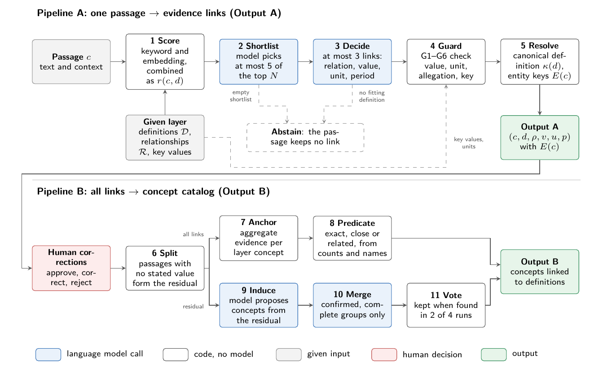
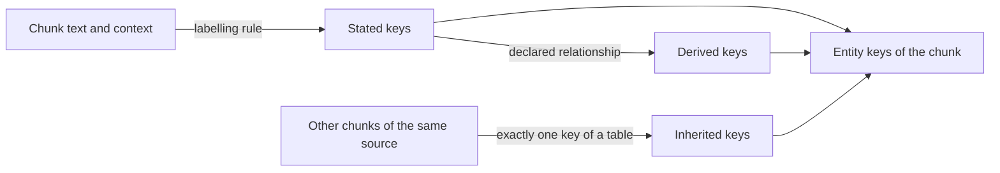

# Pipeline A: evidence links

Pipeline A turns one passage into evidence links, or into an abstention.
A model picks among retrieved definitions.
Code then checks the value, settles the relation, resolves the canonical definition and attaches entity keys.

**Input:** chunks of readable sources, the semantic model, the structured data (for entity keys).
**Output:** Output A, one or more evidence-link records per chunk.



*Figure 2 of the paper. Blue steps call a language model. White steps are code.
A passage with an empty shortlist or no fitting definition keeps no link.*

## The five steps

| Step | Who | What |
| --- | --- | --- |
| 1 Score | Code | Keyword and embedding scores for every definition, combined |
| 2 Shortlist | Model | Picks at most five definitions from the top list |
| 3 Decide | Model | Returns at most three links: definition, relation, value, unit, period |
| 4 Guard | Code | Guards G1 to G6 check value, unit, allegation and key |
| 5 Resolve | Code | Canonical definition and entity keys |

## 1. Score

The query is the passage with its context.
Each definition has a text card.

Two scores are computed for every definition.

- **Embedding.** The cosine between the passage and the card, both from `mistral-embed`.
  It is turned into a standard score over the whole catalog.
  The standard score removes the per-query offset of embedding similarity.
- **Keyword.** A keyword score over labels, synonyms and descriptions.

Both are clipped to the range 0 to 1.
The keyword score is divided by 45.
The standard score maps 2.0 to 0 and 4.5 to 1.
The two are combined so that strong evidence from either leg counts:

```text
r = 1 - (1 - keyword) * (1 - embedding)
```

The constants 45, 2.0 and 4.5 were set on development data and are not tuned further.

!!! note "Retrieval proximity is not confidence"
    `r` is retrieval proximity. It is not a confidence.

## 2. Shortlist

The default candidate method is **two-step**.

| Setting | Value | Variable |
| --- | --- | --- |
| Catalog size at or below which the whole catalog is offered | 150 | `V2_WHOLE_CATALOG_MAX` |
| First-step list size otherwise, by retrieval score | 60 | `V2_SHORTLIST_POOL` |
| Shortlist size | at most 5 | — |
| Extra retrieval candidates added to a shortlist | 0 | `V2_SHORTLIST_EXTRA` |
| Prompts | `shortlist-v2`, then `interp-v3` | `V2_INTERPRET_PROMPT` for the second |

A model reads a compact list: id, label and one line per definition.
It returns at most five ids.
A reply naming an id outside the list is invalid. Nothing is substituted.
An empty shortlist is an abstention, with no second call.

The first design used hybrid-12: the union of the top 12 of each leg.
Embedding ranking alone placed the right definition in the top 12 for only 0.52 (finance) and 0.69 (manufacturing) of positive passages on development data.
A short single list therefore caps recall.
That result motivated a wide first list with a model shortlist.

`V2_CANDIDATE_VARIANT` selects another method: `lexical`, `vector`, `hybrid12`, `hybrid30`, `hybrid50`, `expanded` or `two_step`.

## 3. Decide

The decision model is `mistral-small-latest`, at temperature 0, with prompt `interp-v3`.
`V2_INTERPRETER_MODEL` overrides the model.
It reads the passage, its context and the full cards of the shortlist.
It returns at most three links, or none.
Each link names a distinct definition from the shortlist.

An invalid item is dropped and noted.
If every item is invalid, the chunk is stored as `degraded`.
Per-chunk calls run on a shared pool of four workers by default.

## 4. Guards

Guards run after the model.

| Guard | Condition | Effect |
| --- | --- | --- |
| G1 value grounding | The normalised value does not occur in the normalised passage | The value is removed |
| G2 allegation | The passage matches an allegation pattern and the relation is `states_value_of` | The relation becomes `is_about` |
| G3 constrained field | Allegation wording, and the definition is a constrained field | The link is withdrawn |
| G4 unit conflict | `states_value_of`, the value has a unit family, and the definition's unit is not in it | The relation becomes `is_about` |
| G5 no value | `states_value_of` with no value | The relation becomes `is_about` |
| G6 key value | The canonical definition is a key column, and the passage holds exactly one existing value of it | The value becomes that key; the relation becomes `states_value_of` |

In the code, G3 also fires for a constrained field in any adverse-media source, with or without allegation wording.
The guards enforce one rule.
`states_value_of` needs a value of that definition for an identifiable entity.
A promise, a target, an allegation, or a different unit, grain or period is `is_about` at most.

## 5. Resolve

### Canonical definition

Two fields joined by a declared relationship can hold one key.
The canonical map follows a non-key foreign-key column to the primary key it references.
Each link stores both the selected definition and the canonical one.
Strict metrics compare the selected definition. Canonical metrics compare the canonical one on both sides.

### Entity keys

Entity keys belong to the chunk.



- A mixed alphanumeric identifier resolves anywhere.
- A bare number resolves only next to a label derived from the model: a column name or the entity word of the table.
- A name alone resolves nothing.

Each key is tagged with how it was found: stated, derived or inherited.

## The stored record

Each link holds:

- chunk, source, source revision and span;
- definition and canonical definition;
- relation, stated value, unit, period;
- entity keys;
- candidates and scores (at most 50 stored);
- method and model revision;
- status: `proposed`, `degraded`, `corrected`, `rejected` or `not_processed`;
- actor and time.

Links are stored in table `v2_evidence_links`.
They can be exported as JSON lines from `/api/evidence-links/export`.

## What the model does and what code does

| Model | Code |
| --- | --- |
| Picks at most five candidate ids | Scores every definition |
| Picks up to three definitions and a relation | Validates every id against the offered list |
| Copies a value, unit and period | Checks the value occurs in the passage |
| | Downgrades or withdraws relations by rule |
| | Resolves canonical definitions and entity keys |

## Results in brief

On the held-out gold set A2 (82 anchors, run once), the model decision step reached precision 0.70.
Thresholds and rules reached 0.29.
On unseen synthetic packs, two-step reached a false-link rate of 0.03 (finance) and 0.01 (manufacturing).
Commitments are the weakest category.
See [Evaluation](evaluation.md).
