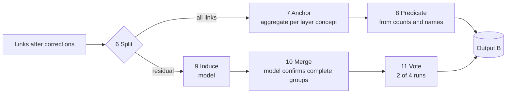

# Pipeline B: concept catalog

Pipeline B reads all evidence links and writes a versioned concept catalog.
Concepts of the layer collect their evidence by aggregation, with no model call.
Code computes each mapping predicate from evidence counts.
Only passages the layer cannot explain reach an induction model.

**Input:** Output A after human corrections, the chunks, the semantic model.
**Output:** Output B, a versioned concept catalog and its Ossie export.

The input links exclude rejected, degraded and unprocessed records.

Steps 9 and 10 call a model. Steps 6, 7, 8 and 11 are code.

## 6. Split

The residual is the set of chunks whose links all have relation `is_about` or `none`.
In other words, the residual holds passages with no stated value.

Three kinds of chunk never enter the residual:

- chunks of sources matched by a form template ([table rows](output-c.md));
- chunks of public sources;
- chunks with a stated value.

A clause chunk that also states an identifier is induced.

## 7. Anchor

Each structured concept of the layer is bound to a set of definitions.
Its evidence is every chunk with a link whose canonical definition is in that set.
No model is called.

For a concept and a definition, each supporting chunk counts once.
It counts as `states_value_of` when one of its links states a value that fits the definition.
Otherwise it counts as `is_about`.

## 8. Predicate

The mapping predicate is derived, not asked of a model.

| Predicate | Condition |
| --- | --- |
| `exactMatch` | More `states_value_of` than `is_about` chunks; more than half of the value chunks select a definition of the same structured concept; and a shared normalised name |
| `closeMatch` | More `states_value_of` than `is_about` chunks, otherwise |
| `relatedMatch` | Otherwise |

Stated values show that passages talk about the field.
Only a shared name shows that the concept means what the field records.

The name test compares the concept's label and synonyms with the label, technical name and synonyms of the definition.

### Link status

| Status | Condition |
| --- | --- |
| `proposed` | At least one value chunk, or at least two `is_about` chunks, or one `is_about` clause that states a value and a unit or a period |
| `candidate` | Otherwise |

The predicate rule changed so that `closeMatch` can fire.
Its agreement with the gold predicates has not been measured since that change.

## 9. Induce

An induction model proposes concepts from the residual.
The model is `mistral-small-latest`.
One concept is one obligation, event, measure, party or attribute.
It has one unit, one grain and one party role.

## 10. Merge

Each concept has a signature: type, unit, role and the canonical definitions it links to.
Two concepts are compatible when no component conflicts.

Candidate pairs come from embedding similarity above 0.90 among compatible pairs.
A model confirms each pair. The model is `mistral-medium-latest`.

A set is merged only if it is a complete group.
Every pair in the group must be compatible and confirmed.
This forbids chains: concept 1 matching concept 2 and concept 2 matching concept 3 does not merge 1 with 3.

## 11. Vote

Induction runs on the full residual set and on three resamples of 80% of it, with fixed seeds.

| Status | Condition |
| --- | --- |
| `proposed` | Found in at least 2 of the 4 runs |
| `candidate` | Otherwise |

Candidates are stored and shown. They are not exported.

## The concept record

| Field | Meaning |
| --- | --- |
| id, label, meaning, synonyms, examples | What the concept is |
| origin | `both` (anchored on a structured concept) or `document` (found in documents only) |
| type, unit, grain | The signature parts |
| links | Definitions with a SKOS predicate and evidence counts |
| evidence | Passages that support the concept |
| status | `proposed` or `candidate`; reviewers may correct or reject |
| level and parent | Position in a two-level hierarchy |

Concepts are versioned rows in `v2_catalog_concept`.

## Build and incremental update

A build is a preview followed by a confirm: `/api/catalog/build/preview`, then `/api/catalog/build/confirm`.

- A failed model reply does not abort a build.
- A unit is retried a bounded number of times.
- A build fails only when more than 10% of units fail.
- Adding one document reuses cached links and keeps every earlier concept id.

The implementer measured a rebuild with cached links at 67 s and 54 s.
Adding one document took 8.6 s and 7.6 s with 6 model calls.

## Export

The catalog is exported in the Ossie format.
The structured concepts and the catalog concepts sit in one concept block.
The export passes the Semantic Hub schema check and lint.
See [Review and release](review-and-release.md).

## Results in brief

On the concept gold set, the anchored design reached link precision 0.70 and recall 0.41 on the first (narrow) corpus.
That row is development data.
The held-out first row, free induction, reached 0.25 and 0.06.
On the wider corpus with two-step, precision fell to 0.45 and recall stayed at 0.29.

Pipeline B can only anchor what Pipeline A links.
Output A commitment recall therefore limits Output B.
See [Evaluation](evaluation.md).
