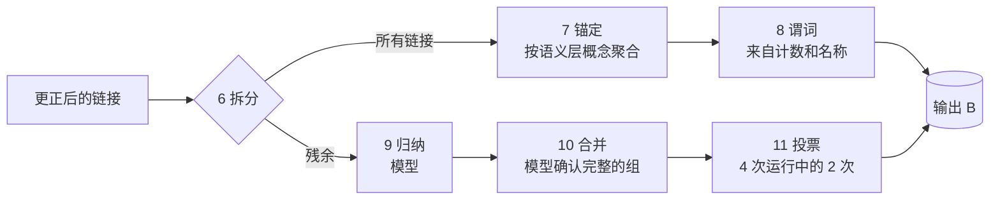

# 管线 B：概念目录

管线 B 读取所有证据链接并写入带版本的概念目录。
语义层的概念通过聚合收集证据，不调用模型。
代码根据证据计数计算每个映射谓词。
只有语义层无法解释的段落才会进入归纳模型。

**输入：** 经过人工更正后的输出 A、分块、语义模型。
**输出：** 输出 B，一个带版本的概念目录及其 Ossie 导出。

输入链接不包括已拒绝、已降级和未处理的记录。

步骤 9 和 10 调用模型。步骤 6、7、8 和 11 是代码。

## 6. 拆分

残余是指所有链接的关系都是 `is_about` 或 `none` 的分块的集合。
换句话说，残余包含没有陈述值的段落。

有三类分块从不进入残余：

- 被表单模板匹配的来源的分块（[表行](output-c.md)）；
- 公开来源的分块；
- 陈述了值的分块。

同时陈述了标识符的条款分块会被归纳。

## 7. 锚定

语义层的每个结构化概念都绑定到一组定义。
它的证据是每个带有链接的分块，且该链接的规范定义在这一组中。
不调用模型。

对一个概念和一个定义，每个支持它的分块只计一次。
当它的某条链接陈述了符合该定义的值时，它计为 `states_value_of`。
否则计为 `is_about`。

## 8. 谓词

映射谓词是推导出来的，不是向模型询问的。

| 谓词 | 条件 |
| --- | --- |
| `exactMatch` | `states_value_of` 分块多于 `is_about` 分块；超过一半的值分块选中同一结构化概念的某个定义；并且有共同的规范化名称 |
| `closeMatch` | `states_value_of` 分块多于 `is_about` 分块，其他情况 |
| `relatedMatch` | 其他情况 |

陈述的值表明段落在谈论该字段。
只有共同的名称才表明概念的含义与该字段记录的内容一致。

名称检验把概念的标签和同义词，与定义的标签、技术名称和同义词做比较。

### 链接状态

| 状态 | 条件 |
| --- | --- |
| `proposed` | 至少有一个值分块，或至少两个 `is_about` 分块，或一个陈述了值以及单位或期间的 `is_about` 条款 |
| `candidate` | 其他情况 |

谓词规则已更改，使 `closeMatch` 可以触发。
更改后，它与金标准谓词的一致性尚未测量。

## 9. 归纳

归纳模型根据残余提出概念。
模型是 `mistral-small-latest`。
一个概念是一项义务、事件、度量、当事方或属性。
它有一个单位、一个粒度和一个当事方角色。

## 10. 合并

每个概念有一个签名：类型、单位、角色和它所链接的规范定义。
当没有任何组成部分冲突时，两个概念兼容。

候选对来自兼容对中嵌入相似度高于 0.90 的那些。
模型逐对确认。该模型是 `mistral-medium-latest`。

只有完整的组才会被合并。
组内的每一对都必须兼容并经确认。
这禁止链式合并：概念 1 匹配概念 2、概念 2 匹配概念 3，并不会把 1 与 3 合并。

## 11. 投票

归纳在完整的残余集和它的三个 80% 重采样上运行，种子固定。

| 状态 | 条件 |
| --- | --- |
| `proposed` | 在 4 次运行中至少 2 次被发现 |
| `candidate` | 其他情况 |

候选被存储并显示。它们不导出。

## 概念记录

| 字段 | 含义 |
| --- | --- |
| id, label, meaning, synonyms, examples | 概念是什么 |
| origin | `both`（锚定在一个结构化概念上）或 `document`（仅在文档中发现） |
| type, unit, grain | 签名的组成部分 |
| links | 带 SKOS 谓词和证据计数的定义 |
| evidence | 支持该概念的段落 |
| status | `proposed` 或 `candidate`；审核者可以更正或拒绝 |
| level and parent | 在两级层次结构中的位置 |

概念是 `v2_catalog_concept` 中带版本的行。

## 构建与增量更新

一次构建是先预览再确认：`/api/catalog/build/preview`，然后是 `/api/catalog/build/confirm`。

- 一次失败的模型答复不会中止构建。
- 一个单元的重试次数有限。
- 只有当超过 10% 的单元失败时，构建才失败。
- 添加一份文档会复用缓存的链接，并保留之前的每个概念 id。

实现者测得使用缓存链接的重建耗时为 67 秒和 54 秒。
添加一份文档耗时 8.6 秒和 7.6 秒，使用 6 次模型调用。

## 导出

目录以 Ossie 格式导出。
结构化概念和目录概念位于同一个概念块中。
导出通过 Semantic Hub 模式检查和 lint。
见[审核与发布](review-and-release.md)。

## 结果简述

在概念金标准集上，锚定设计在第一个（窄）语料上达到链接精确率 0.70 和召回率 0.41。
该行是开发数据。
留出的第一行，自由归纳，达到 0.25 和 0.06。
在更宽的语料上使用两步法，精确率降到 0.45，召回率保持在 0.29。

管线 B 只能锚定管线 A 链接的内容。
因此输出 A 对承诺的召回率限制了输出 B。
见[评估](evaluation.md)。
