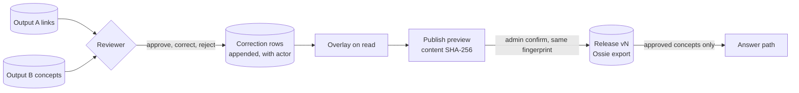

# Review and release

People decide what the system believes.
A reviewer approves, corrects or rejects evidence links, concepts and concept links.
An administrator publishes the approved catalog as a versioned release.
Only approved concepts of the latest release reach answers.

## Corrections

A correction is an appended row.
It records the dataset, the kind, the key, the patch, the actor and the time.
The pipeline records are never changed.
Corrections are overlaid on read.

| Kind | What a patch may change |
| --- | --- |
| Evidence link | Relation, stated value, unit, period, definition, status |
| Concept | Label, definition, status |
| Concept link | SKOS predicate, status |

Statuses are `proposed`, `corrected` and `rejected`.
An approval is a patch that sets status `corrected`.
A rejection sets status `rejected`.

Concept-link predicates may be `exactMatch`, `closeMatch`, `broadMatch`, `narrowMatch` or `relatedMatch`.
Code proposes `exactMatch`, `closeMatch` or `relatedMatch`. A reviewer may choose any of the five.

### Approve all

Approve all approves the listed links or concepts in one transaction.
Each item passes the checks of a single correction.
One unknown or withheld item refuses the whole request.
Rejected and already approved items are skipped, so a second click writes nothing.

!!! warning "Approval is the only gate"
    An approved but doubtful link shapes answers.
    The paper gives one example: "sales tax" linked to a purchase-order tax field.
    Approval, including the one-click Approve all, is the only gate.

### Corrections survive a rebuild

Corrections are keyed by the concept id, by the concept and definition, or by the chunk and its original definition.
A rebuild keeps earlier concept ids.
Corrections therefore overlay the rebuilt catalog the same way.

### Effect on other outputs

Corrections reach Pipeline B, which reads links after corrections.
They also reach [table rows](output-c.md).
A rejected template link shows as a cell removed by a reviewer.
A corrected value is checked again and marked with its actor.
A correction made after a row preview makes that preview stale.

## Release

A release is the dataset's base model plus an extension block.
The extension holds:

- the catalog concepts, without candidates and without anything a correction rejected;
- their definition links, without rejected links;
- evidence references;
- the saved mapping corrections;
- a `release` block.

The base model inside the release is unchanged.
Releases are rows of `v2_release` in the private PostgreSQL. Nothing else is written.

### Preview and confirm

Publishing is limited to the administrator.

1. The preview computes the release and its fingerprint, the content SHA-256.
2. The confirm recomputes the release and writes it only if the fingerprint still matches.

The history lists every version.
A release with content from a source the account cannot read is hidden from that account.

### Format

The release is an Ossie YAML file.
The export passes the Semantic Hub schema check and lint.
Each version can be downloaded from `/api/publish/release`.

## What reaches answers

| Item | Reaches answers |
| --- | --- |
| Approved concept in the latest release | Yes |
| Proposed concept in the latest release | No |
| Candidate concept | No; candidates are never exported |
| Concept in an older release | No |
| Concept with any evidence passage withheld from the reader | No, for that reader |
| Evidence links | Their entity keys are read by the answer path |

A concept is left out for a reader when any one of its evidence passages is withheld from that reader.
The concept's label and synonyms are written from all its passages.
One withheld passage could leak through them.

The switch `V2_ASK_CATALOG` controls this input.
It is on (`published`) by default. Any other value turns it off.

### How approved concepts are used

When a question states the label or a synonym of an approved concept, the answer path offers that name.
It offers the name beside the definitions the concept links with `exactMatch`, or else with `closeMatch`.
Narrowing rules keep a name out in several cases.
See [Ask](ask.md).

### Measured effect

The paper replayed every development set with the catalog off, on with no release, and on with every anchored concept approved.
No question changed status or answer in any set.
A concept named a usable definition in 23 of 296 questions. The plan used that definition in 16.
The structured model already carries almost every useful synonym.

The mechanism broke no answer on these sets.
A benefit is not shown.
A benefit needs data whose business vocabulary differs from the model's names.
These are the implementer's numbers on recorded replies.
