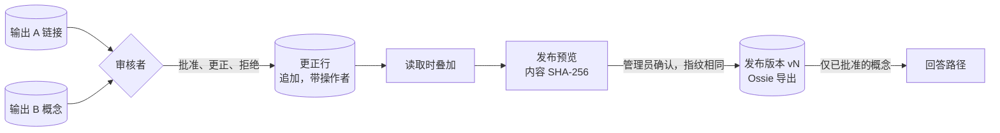

# 审核与发布

由人决定系统相信什么。
审核者批准、更正或拒绝证据链接、概念和概念链接。
管理员把已批准的目录作为带版本的发布版本发布。
只有最新发布版本中已批准的概念才会进入回答。

## 更正

更正是追加的一行。
它记录数据集、类型、键、补丁、操作者和时间。
管线的记录从不被更改。
更正在读取时叠加。

| 类型 | 补丁可以更改的内容 |
| --- | --- |
| 证据链接 | 关系、陈述的值、单位、期间、定义、状态 |
| 概念 | 标签、定义、状态 |
| 概念链接 | SKOS 谓词、状态 |

状态是 `proposed`、`corrected` 和 `rejected`。
批准是把状态设为 `corrected` 的补丁。
拒绝把状态设为 `rejected`。

概念链接的谓词可以是 `exactMatch`、`closeMatch`、`broadMatch`、`narrowMatch` 或 `relatedMatch`。
代码提出 `exactMatch`、`closeMatch` 或 `relatedMatch`。审核者可以选择五个中的任何一个。

### 全部批准

全部批准在一个事务中批准所列出的链接或概念。
每一项都要通过单次更正的检查。
只要有一项未知或不可见，整个请求就被拒绝。
已拒绝和已批准的项会被跳过，因此第二次点击不会写入任何内容。

!!! warning "批准是唯一的关口"
    一条已批准但有疑问的链接会影响回答。
    论文给出一个例子：“sales tax”（销售税）被链接到一个采购订单税字段。
    批准，包括一键的全部批准，是唯一的关口。

### 更正在重建后依然有效

更正以概念 id、概念与定义的组合，或分块与其原始定义的组合为键。
重建会保留之前的概念 id。
因此，更正以同样的方式叠加到重建后的目录上。

### 对其他输出的影响

更正会到达管线 B，它读取更正后的链接。
它们也会到达[表行](output-c.md)。
被拒绝的模板链接显示为审核者移除的单元格。
更正后的值会被重新检查，并标上它的操作者。
在行预览之后进行的更正会使该预览过期。

## 发布版本

发布版本是数据集的基础模型加上一个扩展块。
扩展块包含：

- 目录概念，不含候选，也不含任何被更正拒绝的内容；
- 它们的定义链接，不含被拒绝的链接；
- 证据引用；
- 已保存的映射更正；
- 一个 `release` 块。

发布版本内的基础模型保持不变。
发布版本是私有 PostgreSQL 中 `v2_release` 的行。不写入其他任何地方。

### 预览与确认

发布仅限管理员。

1. 预览计算发布版本及其指纹，即内容 SHA-256。
2. 确认重新计算发布版本，只有指纹仍然匹配时才写入。

历史记录列出每个版本。
包含账户无法读取的来源内容的发布版本，对该账户隐藏。

### 格式

发布版本是一个 Ossie YAML 文件。
导出通过 Semantic Hub 模式检查和 lint。
每个版本都可以从 `/api/publish/release` 下载。

## 什么会进入回答

| 项目 | 是否进入回答 |
| --- | --- |
| 最新发布版本中已批准的概念 | 是 |
| 最新发布版本中已提议的概念 | 否 |
| 候选概念 | 否；候选从不导出 |
| 较早发布版本中的概念 | 否 |
| 任一证据段落对读者不可见的概念 | 对该读者否 |
| 证据链接 | 回答路径读取它们的实体键 |

当一个概念的任何一个证据段落对某个读者不可见时，该概念对这位读者被排除。
概念的标签和同义词是根据它所有的段落写成的。
一个不可见的段落可能通过它们泄露。

开关 `V2_ASK_CATALOG` 控制这一输入。
它默认开启（`published`）。任何其他值都会关闭它。

### 已批准的概念如何使用

当问题陈述了已批准概念的标签或同义词时，回答路径会提供该名称。
它把该名称与概念通过 `exactMatch` 链接的定义一起提供，没有 `exactMatch` 时则与通过 `closeMatch` 链接的定义一起提供。
在若干情况下，收窄规则会阻止提供某个名称。
见[提问](ask.md)。

### 测得的效果

论文在三种情况下重放了每个开发集：目录关闭、开启但没有发布版本、开启且每个锚定概念都已批准。
在任何集合中，没有任何问题的状态或回答发生变化。
在 296 个问题中，有 23 个问题的概念给出了可用的定义。计划使用了其中的 16 个。
结构化模型已经带有几乎所有有用的同义词。

这一机制在这些集合上没有破坏任何回答。
没有证明它有益处。
要体现益处，需要业务词汇与模型名称不同的数据。
这些是实现者在已记录的答复上得到的数字。
