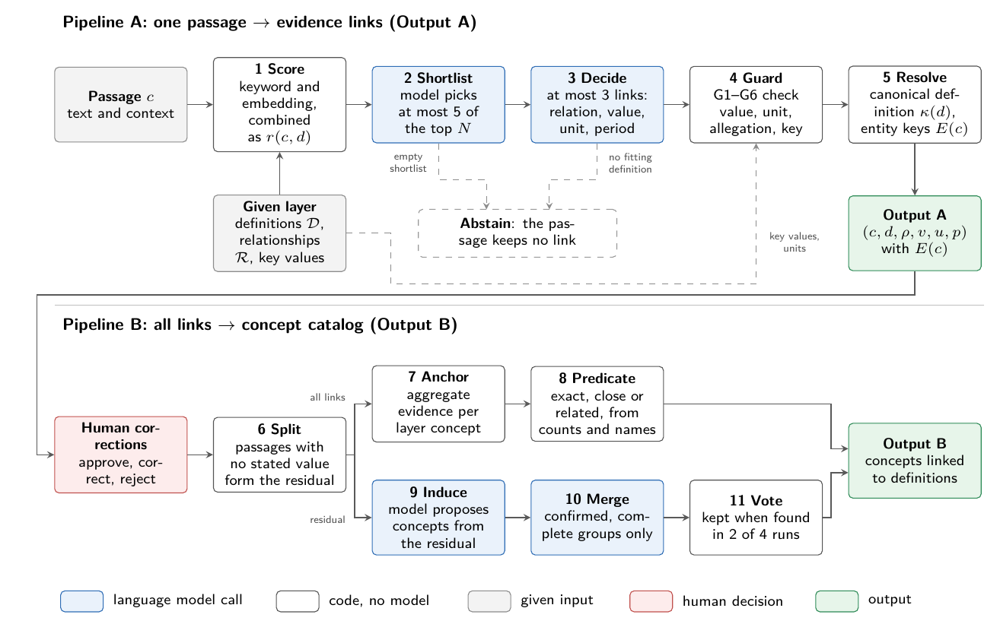
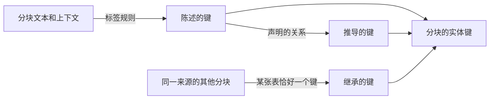

# 管线 A：证据链接

管线 A 把一个段落变成证据链接，或变成一次弃权。
模型在检索到的定义中做选择。
然后代码检查值、确定关系、解析规范定义并附加实体键。

**输入：** 可读来源的分块、语义模型、结构化数据（用于实体键）。
**输出：** 输出 A，每个分块一条或多条证据链接记录。



*论文的图 2。蓝色步骤调用语言模型。白色步骤是代码。
候选清单为空或没有合适定义的段落不保留链接。*

## 五个步骤

| 步骤 | 执行者 | 内容 |
| --- | --- | --- |
| 1 打分 | 代码 | 为每个定义计算关键词得分和嵌入得分，并合并 |
| 2 候选清单 | 模型 | 从靠前的列表中最多选出五个定义 |
| 3 决策 | 模型 | 最多返回三条链接：定义、关系、值、单位、期间 |
| 4 防护 | 代码 | 防护规则 G1 至 G6 检查值、单位、指控和键 |
| 5 解析 | 代码 | 规范定义和实体键 |

## 1. 打分

查询是带上下文的段落。
每个定义有一张文本卡。

为每个定义计算两个得分。

- **嵌入。** 段落与定义卡的余弦值，两者都来自 `mistral-embed`。
  它被转换成整个目录上的标准分。
  标准分消除了嵌入相似度中每个查询的偏移。
- **关键词。** 基于标签、同义词和描述的关键词得分。

两者都被截断到 0 至 1 的范围。
关键词得分除以 45。
标准分把 2.0 映射为 0，把 4.5 映射为 1。
两者合并，使任一路的强证据都能计入：

```text
r = 1 - (1 - keyword) * (1 - embedding)
```

常数 45、2.0 和 4.5 是在开发数据上设定的，没有进一步调优。

!!! note "检索接近度不是置信度"
    `r` 是检索接近度。它不是置信度。

## 2. 候选清单

默认的候选方法是**两步法**。

| 设置 | 值 | 变量 |
| --- | --- | --- |
| 目录大小不超过此值时，提供整个目录 | 150 | `V2_WHOLE_CATALOG_MAX` |
| 否则按检索得分排出的第一步列表大小 | 60 | `V2_SHORTLIST_POOL` |
| 候选清单大小 | 最多 5 | — |
| 加入候选清单的额外检索候选 | 0 | `V2_SHORTLIST_EXTRA` |
| 提示词 | `shortlist-v2`，然后是 `interp-v3` | 第二个由 `V2_INTERPRET_PROMPT` 设置 |

模型读取一份紧凑列表：每个定义一行，含 id、标签和一行说明。
它最多返回五个 id。
答复中出现列表之外的 id 即为无效。不做任何替换。
空的候选清单是一次弃权，不进行第二次调用。

最初的设计是 hybrid-12：两路各取前 12 的并集。
在开发数据上，仅靠嵌入排序，正例段落中正确定义进入前 12 的比例只有 0.52（金融）和 0.69（制造）。
因此，短的单一列表限制了召回率。
这一结果促成了“宽的第一步列表加模型候选清单”的设计。

`V2_CANDIDATE_VARIANT` 选择另一种方法：`lexical`、`vector`、`hybrid12`、`hybrid30`、`hybrid50`、`expanded` 或 `two_step`。

## 3. 决策

决策模型是 `mistral-small-latest`，温度为 0，提示词为 `interp-v3`。
`V2_INTERPRETER_MODEL` 可覆盖该模型。
它读取段落、段落的上下文和候选清单中各定义的完整卡片。
它最多返回三条链接，也可以一条都不返回。
每条链接指向候选清单中一个不同的定义。

无效的项会被丢弃并记录。
如果每一项都无效，该分块被存为 `degraded`。
每个分块的调用默认运行在由四个工作线程组成的共享池上。

## 4. 防护规则

防护规则在模型之后运行。

| 防护规则 | 条件 | 效果 |
| --- | --- | --- |
| G1 值落地 | 规范化后的值没有出现在规范化后的段落中 | 删除该值 |
| G2 指控 | 段落匹配指控模式，且关系是 `states_value_of` | 关系变为 `is_about` |
| G3 受约束字段 | 有指控措辞，且该定义是受约束字段 | 撤回该链接 |
| G4 单位冲突 | `states_value_of`，值有单位族，且定义的单位不在其中 | 关系变为 `is_about` |
| G5 无值 | 没有值的 `states_value_of` | 关系变为 `is_about` |
| G6 键值 | 规范定义是键列，且段落恰好包含它的一个已有值 | 值变为该键；关系变为 `states_value_of` |

在代码中，对任何负面媒体来源中的受约束字段，无论有没有指控措辞，G3 也会触发。
这些防护规则执行同一条规则。
`states_value_of` 需要为一个可识别的实体给出该定义的值。
承诺、目标、指控，或不同的单位、粒度或期间，最多只能是 `is_about`。

## 5. 解析

### 规范定义

由声明的关系连接的两个字段可以持有同一个键。
规范映射从非键的外键列追到它所引用的主键。
每条链接同时保存选中的定义和规范定义。
严格指标比较选中的定义。规范指标在两侧都比较规范定义。

### 实体键

实体键属于分块。



- 字母数字混合的标识符在任何位置都可解析。
- 单独的数字只有紧跟从模型推导出的标签时才可解析：列名，或该表的实体词。
- 单独的名称不解析任何东西。

每个键都标记它是如何找到的：陈述、推导或继承。

## 存储的记录

每条链接包含：

- 分块、来源、来源修订版本和跨度；
- 定义和规范定义；
- 关系、陈述的值、单位、期间；
- 实体键；
- 候选及其得分（最多存储 50 个）；
- 方法和模型修订版本；
- 状态：`proposed`、`degraded`、`corrected`、`rejected` 或 `not_processed`；
- 操作者和时间。

链接存储在表 `v2_evidence_links` 中。
它们可以从 `/api/evidence-links/export` 导出为 JSON 行。

## 模型做什么，代码做什么

| 模型 | 代码 |
| --- | --- |
| 最多选出五个候选 id | 为每个定义打分 |
| 选出最多三个定义和一个关系 | 对照所提供的列表验证每个 id |
| 复制一个值、单位和期间 | 检查该值是否出现在段落中 |
| | 按规则降级或撤回关系 |
| | 解析规范定义和实体键 |

## 结果简述

在留出的金标准集 A2（82 个锚点，运行一次）上，模型决策步骤的精确率达到 0.70。
阈值和规则达到 0.29。
在未见的合成数据包上，两步法的误链接率为 0.03（金融）和 0.01（制造）。
承诺是最弱的类别。
见[评估](evaluation.md)。
